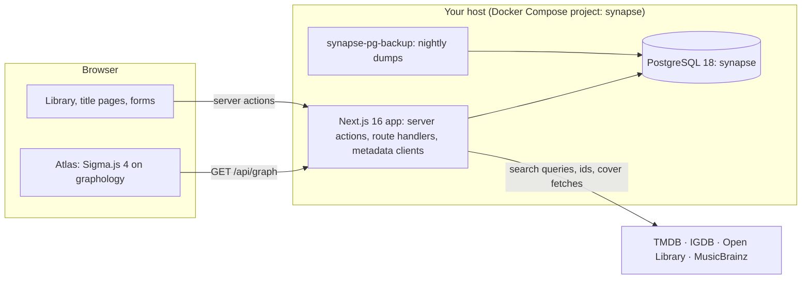

# Synapse Phase 1: Core graph

| Field            | Value                                                                  |
| ---------------- | ---------------------------------------------------------------------- |
| Status           | Accepted                                                               |
| Milestone        | Phase 1: Core graph                                                    |
| Estimated effort | 8 weeks                                                                |
| Depends on       | None. It's the first phase, and it follows the accepted research in #2 |

## 1. Executive summary

Phase 1 builds the core of Synapse: a self-hosted, single-user web app where you add the films,
TV series, games, books, and albums you've lived with, tag them with your own themes, tropes, and
tones, connect them by hand, and log how each one landed. That means a multi-dimensional
resonance score with a private note, optional private mood and context, and text key moments.
You then see it all as a graph in the **Atlas** view. A **Library** list, a global search, a
full JSON export, nightly backups, and a release pipeline make it safe to use every day from the
start.

It comes first because every later phase builds on this graph and its data. Imports (Phase 2),
automatic edges (Phase 3), journeys (Phase 4), and insights (Phase 5) add behavior to the
tables and views made here; they don't reshape them. The stack and the phase order come from the
research on #2, accepted on 2026-11-22. It's recorded in
[ADR 0001](../decisions/0001-self-hosted-nextjs-and-postgresql.md) and
[ADR 0002](../decisions/0002-graph-as-postgres-tables-with-sigma-and-graphology.md).

## 2. Goals and non-goals

### 2.1 Goals

- Run Synapse with one `docker compose up` on your own host, behind sign-in, on the
  finance-stack pattern (ADR 0001), side by side with a running finance-stack.
- Add a title by searching TMDB (film and TV), IGDB (games), Open Library (books), or
  MusicBrainz (albums and artists), or by hand. A search result that's already in Synapse can't
  be added again, and a title added by hand warns you first when one with the same name and
  medium exists.
- Tag titles with free-form themes, tropes, and tones, created inline as you type.
- Draw typed edges between any two nodes by hand, with a weight and a rationale.
- Log each consumption (several per title, for rewatches and replays) with a 0–10 resonance
  score on six dimensions, with a note, and optional mood and context. The note, mood, and
  context stay private.
- Capture text key moments as nodes that you can search and that appear on the graph.
- See the whole graph in Atlas: a WebGL graph whose clusters are named by their themes, with a
  detail panel, filters, and a stable layout that doesn't reshuffle between visits.
- Browse everything in a sortable, filterable Library list, and find anything with a global
  search.
- Keep the data safe and portable, with nightly database backups, a full JSON export, and
  versioned releases whose upgrades take a backup first.

### 2.2 Non-goals

- **Imports and sync** from Letterboxd, Goodreads, Steam, Trakt, Spotify, Rate Your Music, PSN,
  or Last.fm, and the Ingest & Capture view. These are Phase 2. Phase 1 has no `listens` or
  `import_runs` tables, and no track or podcast entry.
- **Automatic edges** from metadata credits, the review queue for them, and zooming into
  clusters. These are Phase 3. Phase 1 keeps the credits it fetches in `metadata` for Phase 3 to
  use, but draws no edges from them.
- **Journeys, pathfinding, and Explore** (Phase 4), **Insights and diet analytics** (Phase 5),
  **sharing and other accounts** (Phase 6), and **any AI** (Phase 7, deferred).
- **Phone and tablet layouts.** Phase 1 supports desktop widths of 1024px and up only (§7.4).
- **Screenshot and image moments.** Moments are text only. Images wait until uploads are needed
  elsewhere.
- **Seasons, episodes, editions, and tracks** as nodes. A TV node is a series, a book is a work,
  and an album is a release group.
- **A JSON import or restore.** Restore is from a database backup (1.17). The export is for
  portability, and re-importing it waits for a need.
- **Down migrations.** Migrations are forward-only, as in finance-stack. The way back is the
  pre-upgrade dump (§5).
- **TLS by default and an audit log.** The default posture is a trusted network (ADR 0001). The
  Caddy edge profile from finance-stack can be added when it's needed.

## 3. Architecture impact

Nothing exists yet, so every part is new. The shape copies finance-stack's, which runs the same
stack under the same dev process: PostgreSQL 18.6 in Compose
(`finance-stack/docker-compose.yml:29`), Next.js 16.4.6 with Auth.js 5 beta, Drizzle, and `pg`
(`finance-stack/app/package.json:35-40`), sign-in with no self-registration
(`finance-stack/README.md:22`), least-privilege database roles (`finance-stack/README.md:33`),
and a trusted-network default with an optional Caddy edge (`finance-stack/README.md:37`).

### 3.1 Services and side-by-side running

finance-stack pins `container_name: postgres` and `pg-backup`
(`finance-stack/docker-compose.yml:30`, `:331`), publishes Postgres on `127.0.0.1:5433`
(`:45`), the app on `3001` (`:220`), Metabase on `127.0.0.1:3000` (`:406`), and GlitchTip on
`127.0.0.1:8000` (`:468`). So Synapse's Compose file sets `name: synapse`, and every service's
`container_name` starts with `synapse-`. Its host ports don't overlap with finance-stack's:

| Service                    | Container name      | Host port                                                                     |
| -------------------------- | ------------------- | ----------------------------------------------------------------------------- |
| `postgres` (18.6)          | `synapse-postgres`  | `127.0.0.1:5434`                                                              |
| `migrate` (one-shot)       | `synapse-migrate`   | None                                                                          |
| `app`                      | `synapse-app`       | `3002`. It's `127.0.0.1:3002` until sign-in lands in 1.1.1 (§4).              |
| `pg-backup` (1.17)         | `synapse-pg-backup` | None                                                                          |

`migrate` creates the roles and applies the Drizzle migrations, as finance-stack's does
(`finance-stack/docker-compose.yml:77`). The databases are `synapse` and `synapse_test`.

### 3.2 The app

- Next.js 16 (App Router, TypeScript, Tailwind 4), with Prettier as the formatter.
- Mutations are server actions in `app/lib/actions/`, validated with zod in
  `app/lib/validations/`, as in finance-stack (`finance-stack/app/lib/actions/`). Reads that a
  client needs to cancel or stream are route handlers under `app/app/api/`.
- Every edge write goes through one validator, `validateEdge` in
  `app/lib/graph/edge-types.ts`. That includes the server actions here, Phase 2's imports, and
  Phase 3's suggestions. It checks the edge type against the node types at each end, the
  direction, and the type's `metadata`.
- The metadata clients are in `app/lib/metadata/`. There's one `MetadataProvider` interface
  with four implementations. They run on the server only, so API keys never reach the browser.
- Adding a title from a provider is a function in `app/lib/metadata/` that takes a database
  handle, with the server action as a thin wrapper, so Phase 2's worker can call it. It fetches
  the details, commits the node and its external id, and only then fetches the cover, so no row
  lock is held during a 10-second cover fetch.
- The security headers and CSP copy `finance-stack/app/lib/security/csp.ts`, with one change:
  `worker-src 'self' blob:`. graphology-layout-forceatlas2 0.10.1 builds its web worker from a
  `blob:` URL (`helpers.js:254-257`). Without `worker-src`, the policy falls back to
  `script-src 'self' 'nonce-…'` (`csp.ts:80-93`), which refuses it. `img-src` stays
  `'self' data:` (`csp.ts:113`). Every cover is served from Synapse's own origin, and `data:`
  images never leave the page.

### 3.3 Interfaces

These payloads carry exactly the keys listed here. Tests assert the full set of keys, so adding a
field means changing the test on purpose (§8).

| Interface                                    | Shape                                                                                                                                                                                                                                                                                      |
| -------------------------------------------- | ------------------------------------------------------------------------------------------------------------------------------------------------------------------------------------------------------------------------------------------------------------------------------------------ |
| `GET /api/graph` (1.10)                      | `{ nodes: [{ id, type, title, year }], edges: [{ id, source, target, type, weight }] }`. Every node except `track` and `podcast` is included, and only `accepted` edges whose two ends are both included, so Phase 2's `track_of` edges never reach Atlas. No `body`, `metadata`, resonance, mood, context, or note. If the performance gate fails, its follow-up issue adds an optional `?minDegree=<n>`, which drops nodes with fewer edges (§4, performance gate). |
| `GET /api/metadata/search?source=&q=` (1.4)  | `{ results: [{ source, externalId, type, title, year, subtitle, existingNodeId }] }`. `subtitle` is a director, author, developer, or artist. `existingNodeId` is set when the result is already in Synapse. There's no cover URL and no thumbnail (§4, Covers). The handler honors `request.signal`, so a canceled request is dropped before it reaches the provider (§4). Adding a result sends only `{ source, externalId }`: the server fetches the title's details and cover from the provider itself.   |
| `GET /api/covers/<node-id>` (1.4)            | The stored bytes, with the stored `Content-Type`, `X-Content-Type-Options: nosniff`, and `Cache-Control: private, max-age=31536000, immutable`. Pages link to it as `/api/covers/<node-id>?v=<fetched_at>`, so a replaced cover shows at once. 404 when there's no cover. Sign-in is required.                                                                                       |
| Library rows (1.14)                          | `{ id, type, title, year, hasCover, latestState, latestRating, themes: [{ id, title }] }`. Consumptions are ordered newest first by `coalesce(finished_on, started_on, created_at)`. `latestState` is the newest one's state. `latestRating` is the overall `rating` from the newest one that has a rating, so planning a rewatch doesn't blank the rating you gave last time.                                                                                                                       |
| Search results (1.15)                        | `{ id, type, title, year, snippet }`. `snippet` comes from `title` and `body` only, so moments are found by their text, and private fields are never searched.                                                                                                                        |
| `GET /api/export` (1.16)                     | `{ format_version: 1, exported_at, nodes, external_ids, edges, consumptions, resonance, consumption_context, covers: [{ node_id, source_url }] }`. It holds every table except `users`, the `node_images` bytes, and `node_positions`. Private fields are included: it's your data. |

### 3.4 CI

`.github/workflows/ci.yml` adds Prettier, lint, typecheck, Vitest (unit and integration, against
a Postgres service), and Playwright to the existing `Verify` job, so the ruleset's required check
doesn't change. 1.18 adds the `v*` release workflow.

## 4. Resolved design decisions

The stack and the graph storage are in ADR 0001 and ADR 0002, and aren't repeated here.

| Decision                         | Resolution                                                                                                                                                                                                                                                                                                                                                                                                                       | Rationale                                                                                                                                                                                                                                                                                                                           |
| -------------------------------- | -------------------------------------------------------------------------------------------------------------------------------------------------------------------------------------------------------------------------------------------------------------------------------------------------------------------------------------------------------------------------------------------------------------------------------- | ----------------------------------------------------------------------------------------------------------------------------------------------------------------------------------------------------------------------------------------------------------------------------------------------------------------------------------- |
| Media in Phase 1                 | Film, TV series, game, book, and album, plus artists (`person` or `group`). Albums and artists are searched on MusicBrainz.                                                                                                                                                                                                                                                                                                      | Music is a medium (the research's revision on #2), and composer and performer links across media are one of Synapse's strongest edges. MusicBrainz is CC0 and needs no key. Deferring music would leave Atlas missing a medium until Phase 2.                                                                                      |
| Private fields                   | Mood, context, and the resonance note are private. All three are optional and logged on the consumption form. Mood and context have their own table, and the note is `resonance.note`. They're loaded only for the title's own page and its Atlas detail panel. They're never part of `/api/graph`, the Library, or search, and Phase 6 gives them no visibility setting, so they can't be shared.                                   | Capturing mood at the time of consumption can't be done after the fact. The note is as personal as the mood, so it's handled the same way. Leaving all three out of the shared read paths now means later sharing can't leak them by accident. Rejected: a public-by-default note, like a Letterboxd review; sharing a review can be a deliberate Phase 6 feature instead. |
| Themes, tropes, and tones        | Free-form nodes, created inline from an autocomplete while you tag a title. They're unique per type, ignoring case. No starter list is seeded.                                                                                                                                                                                                                                                                                  | A seeded taxonomy is opinionated, and it shapes clusters before you've said anything. Rejected: a seed of about 50 common themes.                                                                                                                                                                                                  |
| Merge and rename                 | Merge applies to the four types whose names are unique (`theme`, `trope`, `tone`, and `universe`), and works only within a type: a theme into a theme, a universe into a universe, and so on. After a confirmation that shows how many titles move, one transaction re-points every edge of the merged node, of every type, to the surviving node. Edges that would become self-loops are deleted. `related` edges are re-normalized so the lower id is the source. Edges that now duplicate one another collapse into one, keeping the higher weight, both rationales (joined by a blank line), and the earlier `created_at`. Then the merged node is deleted. Renaming any of the four to a name that already exists for that type offers the merge instead. | Merge makes up for the duplicates that free entry creates, and it has to leave the graph satisfying every constraint in §5. Merging across types would quietly change what a tag means and which cluster label it feeds, so to move a tag to a different kind, you re-tag. Rejected: merging across types; undo, because the confirmation and the backups cover a mistake. |
| Tagging is an edge               | Tagging a title with a theme creates a `tagged` edge (title → theme) with `origin = manual`, `status = accepted`. A theme's kind comes from its node type.                                                                                                                                                                                                                                                                      | Themes are nodes, so tags pull titles into theme clusters on Atlas with no special case, and Phase 3's review queue and Phase 4's paths treat them like any other edge. Rejected: a separate tags table, which Atlas would have to merge into the graph.                                                                         |
| Edge types and direction         | A fixed set, with its direction and allowed node types defined once in `app/lib/graph/edge-types.ts` (§5.1), and the type names enforced by a check constraint.                                                                                                                                                                                                                                                                | Typed, directed edges are what make Phase 4's paths and Phase 5's metrics meaningful. A check constraint can be replaced in a later migration, while a Postgres enum can't drop a value. Rejected: user-defined edge types, which fragment the graph; the edge's free-text rationale carries the nuance.                         |
| Credit roles                     | One `credit` edge per person (or group, studio, or label) and title, with its roles as a non-empty array in `metadata.roles`, from the fixed list in §5.1. Adding a second role to an existing credit adds to the array.                                                                                                                                                                                                       | Someone who wrote and directed a film is one relationship with two roles. That keeps edge counts and paths honest, and the unique key on `(source_id, target_id, type)` still holds. Phase 3's automatic credits merge roles in the same way. Rejected: a `role` column in the unique key, which would draw several edges between the same two nodes. |
| Directed edges                   | Edges are stored source → target. `related` is symmetric and is stored once, with the lower id as the source. A rejected edge keeps its row, so Phase 3 won't suggest it again.                                                                                                                                                                                                                                                | One row per relationship keeps counts and paths honest. The database enforces the rules (§5).                                                                                                                                                                                                                                      |
| Ids                              | `uuid` keys, defaulting to Postgres 18's built-in `uuidv7()`.                                                                                                                                                                                                                                                                                                                                                                  | They're stable across export and a future import, they don't reveal how many rows exist once sharing arrives in Phase 6, and they sort by time. Rejected: `bigint` identity columns.                                                                                                                                              |
| Deduplicating titles             | External ids live in `external_ids (node_id, source, external_id)` with `unique (source, external_id)`. `source` names both the provider and the id's namespace: `tmdb_movie`, `tmdb_tv`, `tmdb_person`, `igdb_game`, `openlibrary_work`, `openlibrary_author`, `musicbrainz_release_group`, `musicbrainz_artist`. Search results already in Synapse are marked, and open the existing node. The by-hand form looks up nodes with the same title (ignoring case) and type as you type. For a title or an entity, it shows "Already in Synapse: open it, or add anyway". For a theme, trope, tone, or universe, whose names are unique, it offers only to open the existing one. | TMDB's movie, TV, and person ids are separate number sequences, so movie 603 and TV series 603 are different titles, and the namespace has to be part of the key. A unique constraint enforces it, rather than application code, and Phase 2's import matching becomes a lookup. One node can hold ids from several sources. Titles added by hand have no external id, so they get a warning rather than a constraint: remakes and different works can share a name. |
| Covers                           | When a title is added from search, the server works out the cover from the result's `source` and `externalId`, never from a URL sent by the browser, and downloads one cover at a fixed small size (TMDB `w342`, IGDB `cover_big`, Open Library `-M`, Cover Art Archive `250`) into `node_images` as `bytea`, and serves it from `/api/covers/<node-id>` (§3.3). The fetch is checked (below).                                                                                                                                            | The browser never contacts a provider's CDN, so what you look at stays on your host. There's one store to back up (ADR 0002). Search results show no thumbnails, because `img-src 'self' data:` would block a provider's CDN, and the year and `subtitle` tell results apart. Rejected: hotlinking, which leaks every title you view; a file volume, which is a second thing to back up; a thumbnail proxy for search results, which would multiply provider requests for every keystroke.                                                                                           |
| Cover fetch checks               | The cover URL comes from a provider's response, so it's untrusted. The server fetches only from `https://` hosts on an allowlist: `image.tmdb.org`, `images.igdb.com`, `covers.openlibrary.org`, `coverartarchive.org`, and `archive.org` with its `*.archive.org` hosts, which Cover Art Archive redirects to. Each redirect is checked against the same list, up to five. A release-group cover from Cover Art Archive already takes three. A fetch times out after 10 seconds and is cut off at 2 MB. The stored type comes from the file's magic bytes, and only JPEG, PNG, and WebP are kept. A failed fetch saves the title without a cover, and the title page offers "Retry cover". | Without these checks, the server fetches whatever a response names and serves it from Synapse's own origin. The allowlist stops requests to internal hosts. Sniffing the bytes, and serving with `nosniff`, stops a hostile file from being served as HTML or script.                                                     |
| Search-as-you-type               | The Add form debounces typing by 300ms and cancels the request in flight when you type again, so the latest query wins. Each provider has a server-side throttle at its limit: MusicBrainz 1 request a second, IGDB 4, Open Library 3 (its documented limit for a client that sends an identifying User-Agent), and TMDB 20 (half of the roughly 40 a second at which TMDB starts answering 429). A queued request whose client has canceled is dropped before it's sent. A provider's 429, 503, or timeout shows "MusicBrainz isn't responding", with a retry.  | MusicBrainz answers 503 above 1 request a second per IP. Without cancellation, a throttle would answer stale queries seconds late. Dropping them keeps the queue short and the results current.                                                                                                                                  |
| Resonance scale                  | Integers from 0 to 10, each nullable: `rating` overall, plus `emotional`, `intellectual`, `aesthetic`, `revisit`, and `changed_thinking`.                                                                                                                                                                                                                                                                                       | It's the research's scale. Letterboxd's half stars and Goodreads' five stars both map onto 0–10 without loss in Phase 2. Null means "not logged", which is different from 0.                                                                                                                                                       |
| Consumption states               | `planned`, `in_progress`, `paused`, `finished`, `abandoned`. Several consumptions per title. `source = manual` in Phase 1.                                                                                                                                                                                                                                                                                                       | `planned` covers the backlog without a separate list. Rewatches and replays are separate rows with their own resonance.                                                                                                                                                                                                            |
| Moments                          | A `moment` node with a short label in `title` (your own, or the first 60 characters of the text), its text in `body`, an optional position (a timestamp, chapter, page, or track) in `metadata`, and exactly one `moment_of` edge to its title. The database enforces at most one (§5). The app keeps it at exactly one: creating a moment inserts the node and its edge in one transaction, `moment_of` edges are written only by the moment actions in 1.9 (`validateEdge` refuses them from anywhere else), and 1.7's edge controls don't list them.                                                                                                                                                                              | Moments become searchable and visible on the graph, as the pitch asks. Rejected: a moments table, which would need its own search and its own place on the graph.                                                                                                                                                                 |
| Deleting                         | Deleting a title asks for confirmation, showing how many consumptions, moments, and edges go with it. One transaction deletes its moment nodes, then the title. The foreign keys cascade the rest: edges, external ids, consumptions, the cover, and the saved position. Deleting a consumption cascades to its resonance and context. Deleting a theme asks for confirmation, showing how many titles lose the tag.               | A `moment_of` edge cascading on its own would leave orphaned moments in search and on Atlas. A cascade from `consumptions` means no private mood row outlives the consumption it describes.                                                                                                                                        |
| Navigation while Phase 1 lands   | Each issue adds its own navigation entry when it lands, so `main` never links to a page that doesn't exist. 1.3 adds `/library` as a plain list of titles, and `/` redirects to it. 1.11 replaces `/` with Atlas, and 1.14 turns the list into the full Library.                                                                                                                                                                  | A release can be cut between any two issues (the pull-request standard's "releasable" rule), so the app is always usable and has no dead links.                                                                                                                                                                                    |
| Sign-in before the first release | 1.1 publishes the app on `127.0.0.1:3002` only. 1.1.1, which adds sign-in, publishes it on `3002` for the trusted network, as finance-stack does (`finance-stack/docker-compose.yml:220`).                                                                                                                                                                                                                | An app with no sign-in is never reachable from another machine, even if a release were cut between 1.1 and 1.1.1, and 1.18 depends on 1.1.1, so none is.                                                                                                                                                                                                                 |
| Atlas clusters                   | Louvain communities, computed in the browser. Each one is labeled with its highest-degree theme, trope, or tone, and color can switch between cluster and medium. Moments are hidden unless you turn them on.                                                                                                                                                                                                                  | Clusters come from the graph itself, so Phases 1–6 need no AI. Naming a cluster by its central theme gives the "cyberpunk" and "found family" regions the pitch describes.                                                                                                                                                       |
| Atlas layout                     | Positions are kept in `node_positions` (1.12). Atlas starts ForceAtlas2 from them, places new nodes beside their neighbors, and saves positions after the layout settles. "Re-layout" recomputes from scratch.                                                                                                                                                                                                                    | An atlas that reshuffles on every visit can't be learned. A separate table means layout writes don't touch `nodes.updated_at`.                                                                                                                                                                                                     |
| Atlas performance gate           | 1.10 loads a generated graph of 10,000 nodes and 30,000 edges and must pass two checks on the owner's desktop: at least 30 fps while panning and zooming, and ForceAtlas2 settling in its worker within 15 seconds. It also measures 50,000 nodes for the record, with no pass mark. If the gate fails, 1.10 records the result and a follow-up issue (1.10.1) is filed so that Synapse draws less: moments and nodes with one edge or none are hidden by default, labels are drawn only above a size threshold, and `/api/graph?minDegree=` filters on the server. Cytoscape.js isn't the fallback for speed, because its canvas renderer is slower than Sigma's WebGL. It stays the fallback only if a hierarchical layout is needed (ADR 0002). | 10,000 nodes is the Phase 1 target, with headroom over the hundreds to few thousand that manual entry produces. The 50,000 measurement tells the Phase 2 proposal, whose imports could reach that size, whether it needs server-side filtering.                                                                                  |
| Search                           | A generated `tsvector` column on `nodes`, built from `title` and `body` with a GIN index, plus `pg_trgm` for fuzzy title matches. Opened with Ctrl+K from anywhere.                                                                                                                                                                                                                                                              | Postgres does both, with no new service. Moments are found by their text, and private fields are never searched, because they aren't on `nodes`.                                                                                                                                                                                  |
| Export                           | `GET /api/export` (§3.3) downloads one JSON file, with a `format_version` of `1`. A test fails if a table is neither exported nor explicitly excluded.                                                                                                                                                                                                                                                                          | Your data is yours to take away, private fields included. The test keeps the export complete as later phases add tables.                                                                                                                                                                                                           |
| Forms                            | A form's submit button is disabled while it saves, and Enter can't submit twice.                                                                                                                                                                                                                                                                                                                                                  | A double click on Add would otherwise create two nodes, because nodes added by hand have no external id to collide on.                                                                                                                                                                                                             |
| Secrets                          | `TMDB_READ_TOKEN`, `TWITCH_CLIENT_ID`, `TWITCH_CLIENT_SECRET` (for IGDB), `METADATA_CONTACT` (for the MusicBrainz and Open Library User-Agent), `AUTH_SECRET`, and the database passwords, all in `.env`, with placeholders in `.env.example`.                                                                                                                                                                                 | The repository is public. MusicBrainz blocks clients that don't send a meaningful User-Agent.                                                                                                                                                                                                                                      |

## 5. Data model changes

Everything here is new. 1.1 adds `users`. 1.2 adds the graph in one migration, and its issue
spec fixes the column-level details. `node_images` (1.4) and `node_positions` (1.12) each come
in a migration of their own.

**The way back.** Migrations are forward-only, because drizzle-kit generates no down migrations.
finance-stack does the same, and rolls back across a schema change by restoring the pre-upgrade
dump (`finance-stack/docs/schema-changes.md:14`). Synapse copies that:

- **Before an upgrade:** the upgrade path takes a dump before `migrate` runs. 1.17 provides the
  dump, and 1.18 the gate that requires it.
- **The `Migration:` marker:** each release declares on its changelog entry whether it has no
  migration (`none`), whether the previous version still runs against the new schema
  (`backward-compatible`), or whether it doesn't (`breaking`). The marker is finance-stack's, not
  the shared process's, and the synced `scripts/dev-process/release.mjs` doesn't check it. So
  1.18 copies finance-stack's gate (`app/scripts/check-changelog.ts`, run by its `release.yml:44`)
  and records the marker in `docs/PROCESS.md` as a project addition.
- **Before 1.18:** nothing has been released, so there's no data to roll back.

| Table                  | Purpose and key columns                                                                                                                                                                                                                                                                                                                                                                               |
| ---------------------- | ----------------------------------------------------------------------------------------------------------------------------------------------------------------------------------------------------------------------------------------------------------------------------------------------------------------------------------------------------------------------------------------------------- |
| `users`                | Auth.js credentials: one owner, created with `npm run auth:create-user`, as in finance-stack.                                                                                                                                                                                                                                                                                                       |
| `nodes`                | `id uuid`, `type` (check: `film`, `tv`, `game`, `book`, `album`, `track`, `podcast`, `person`, `group`, `studio`, `label`, `theme`, `trope`, `tone`, `universe`, `moment`), `title` (not empty), `year smallint null`, `body text null`, `metadata jsonb`, `visibility` (`private` by default; `shared` and `public` are reserved for Phase 6), `search tsvector` generated, `created_at`, `updated_at`. `track` and `podcast` are allowed now so that Phase 2 needs no constraint change. A unique index on `(type, lower(title))` applies to `theme`, `trope`, `tone`, and `universe`. |
| `external_ids`         | `node_id → nodes`, `source` (check: the eight values in §4), `external_id`, with `unique (source, external_id)`.                                                                                                                                                                                                                                                                                     |
| `edges`                | `id`, `source_id → nodes`, `target_id → nodes`, `type` (check: §5.1), `weight real` from 0 to 1 (default 0.5), `origin` (`manual`, `metadata`, `import`), `status` (`accepted`, `suggested`, `rejected`), `rationale text null`, `metadata jsonb`, `created_at`. The research's `created_by_run` arrives with `import_runs` in Phase 2, as a nullable column.                                         |
| `consumptions`         | `id`, `node_id → nodes`, `started_on date null`, `finished_on date null`, `state`, `platform text null`, `source` (`manual`), `created_at`.                                                                                                                                                                                                                                                          |
| `resonance`            | `consumption_id` (primary key, `→ consumptions`, cascading), `rating`, `emotional`, `intellectual`, `aesthetic`, `revisit`, `changed_thinking` (each `smallint null`, checked to be 0–10), and `note text null`, which is private (§4).                                                                                                                                                            |
| `consumption_context`  | `consumption_id` (primary key, `→ consumptions`, cascading), `mood text null`, `context text null`. It's always private, with no visibility column, and it's never read by `/api/graph` (§4).                                                                                                                                                                                                     |
| `node_images` (1.4)    | `node_id` (primary key, `→ nodes`), `content_type` (check: `image/jpeg`, `image/png`, `image/webp`), `bytes bytea` (at most 2 MB), `source_url`, `fetched_at`.                                                                                                                                                                                                                                       |
| `node_positions` (1.12) | `node_id` (primary key, `→ nodes`), `x real`, `y real`, `updated_at`.                                                                                                                                                                                                                                                                                                                              |

**Constraints the database enforces**, each with an integration test (§8):

- Every foreign key to `nodes` cascades on delete, and so do `resonance` and
  `consumption_context` from `consumptions`.
- `edges`: `unique (source_id, target_id, type)`; `source_id <> target_id`, so there are no
  self-loops; `type <> 'related' OR source_id < target_id`; and a unique partial index on
  `(source_id) WHERE type = 'moment_of'`, so a moment belongs to one title.
- `consumptions`: `finished_on >= started_on` when both are set.

The allowed node types at each end of an edge are checked by `validateEdge` (§3.2), not by the
database, because a check constraint can't read the other table. `origin`, `status`, and
`visibility` exist from the first migration, so that Phase 3's review queue and Phase 6's sharing
add behavior without reshaping stored data (ADR 0002). The app's database role has DML on these
tables and no DDL.

### 5.1 Edge types

"Title" means `film`, `tv`, `game`, `book`, or `album` (and `track` or `podcast` from Phase 2).
"Entity" means `person`, `group`, `studio`, or `label`.

| Type                     | Source → target                      | Meaning, read source to target         | `metadata`                                                                                                                                  |
| ------------------------ | ------------------------------------ | -------------------------------------- | ------------------------------------------------------------------------------------------------------------------------------------------- |
| `tagged`                 | title → `theme`, `trope`, or `tone`  | The title has this theme               | None                                                                                                                                        |
| `credit`                 | entity → title                       | The entity worked on the title         | `roles`: a non-empty array of `director`, `writer`, `author`, `creator`, `developer`, `publisher`, `composer`, `performer`, `producer`, `actor`, `designer`, `cinematographer`, `illustrator`, `narrator`, `translator` |
| `adaptation_of`          | title → title                        | Source adapts target                   | None                                                                                                                                        |
| `sequel_of`              | title → title                        | Source follows target                  | None                                                                                                                                        |
| `remake_of`              | title → title                        | Source remakes target                  | None                                                                                                                                        |
| `spiritual_successor_of` | title → title                        | Source carries target's spirit on      | None                                                                                                                                        |
| `influenced_by`          | title or entity → title or entity    | Target influenced source               | None                                                                                                                                        |
| `in_universe`            | title → `universe`                   | The title is set in the universe       | None                                                                                                                                        |
| `member_of`              | `person` → `group`                   | The person is or was in the group      | None                                                                                                                                        |
| `moment_of`              | `moment` → title                     | The moment is from the title           | None                                                                                                                                        |
| `related`                | title or entity ↔ title or entity    | Undirected; lower id is the source     | None                                                                                                                                        |

## 6. Issue breakdown

| Id    | Issue                              | Description                                                                                                                                                                                                                                                                                                                                                                                                                                                                                                                                                                                                                                                                                                                                                   | Area     | Priority | Size | PRs | Depends on                           |
| ----- | ---------------------------------- | ------------------------------------------------------------------------------------------------------------------------------------------------------------------------------------------------------------------------------------------------------------------------------------------------------------------------------------------------------------------------------------------------------------------------------------------------------------------------------------------------------------------------------------------------------------------------------------------------------------------------------------------------------------------------------------------------------------------------------------------------------------- | -------- | -------- | ---- | --- | ------------------------------------ |
| 1.1   | App scaffold                       | Compose with `postgres`, `migrate`, and `app`, named for running beside finance-stack (§3.1), with the app on `127.0.0.1:3002` only; Next.js 16 with Tailwind, shadcn on Base UI, next-themes, and Prettier; the version in `app/package.json`; least-privilege roles and the `users` table; Prettier, lint, typecheck, the runtime dependency audit, Vitest, and Playwright in `Verify`; npm in Dependabot; a README for setup (`.env`). It fills in the Format, Unit, End-to-end, and Run facts in `CLAUDE.md` and the test levels in `docs/PROCESS.md`. Part 1: the app and its toolchain in `Verify`. Part 2: the audit and npm in Dependabot. Part 3: Postgres, migrate, the roles, and the integration tests. Part 4: the app container and the README. | infra    | P0       | M    | 4   | None                                 |
| 1.1.1 | Sign-in and security headers       | Auth.js single-user sign-in with `auth:create-user` and the sign-in rate limit; signed-out pages redirect to sign-in, and signed-out API routes answer 401; the security headers and CSP with `worker-src 'self' blob:` (§3.2) on every response; then the app published on `3002` for the trusted network (§4, Sign-in before the first release). Part 1: the headers and CSP. Part 2: sign-in and the binding. Split from 1.1 by its design review.                                                                                                                                                                                                                                                                                                         | infra    | P0       | M    | 2   | 1.1                                  |
| 1.2   | Data model                         | The first graph migration: `nodes`, `external_ids`, `edges`, `consumptions`, `resonance`, and `consumption_context`, with every constraint and index in §5 and the search column. The Drizzle schema, `validateEdge` and the edge types in `app/lib/graph/edge-types.ts` (§5.1), and integration tests for every constraint.                                                                                                                                                                                                                                                                                                                                                                                                                                  | database | P0       | M    | 1   | 1.1                                  |
| 1.3   | Titles by hand                     | Add, edit, and delete a title (film, TV, game, book, album) or an entity (person, group, studio, label, universe) by hand, with the same-name warning (§4), the delete confirmation, and disabled submit while saving. The title page at `/nodes/[id]`. `/library` as a plain list of titles, with `/` redirecting to it, and the first navigation entries: Library and Add.                                                                                                                                                                                                                                                                                                                                                                                  | ui       | P0       | M    | 1   | 1.2                                  |
| 1.4   | Add films, TV, and books by search | The `MetadataProvider` interface and `/api/metadata/search` (§3.3) with cancellation and per-provider throttles; TMDB and Open Library clients; the `node_images` migration, the checked cover fetch, and `/api/covers`; marking results already in Synapse; the search-as-you-type Add flow with its error and fallback states; attribution on `/about`. Part 1: the interface, covers, and TMDB. Part 2: Open Library and the finished Add flow.                                                                                                                                                                                                                                                                                                            | api      | P0       | M    | 2   | 1.3                                  |
| 1.5   | Add games and music by search      | The IGDB client, with its Twitch client-credentials token, and the MusicBrainz client: release groups as albums, and artists as `person` or `group`. Both join the Add flow and the attribution page.                                                                                                                                                                                                                                                                                                                                                                                                                                                                                                                                                         | api      | P0       | M    | 1   | 1.4                                  |
| 1.6   | Themes, tropes, and tones          | Tag a title inline from an autocomplete that creates new themes, tropes, and tones; remove tags; a page per theme that lists its titles; rename, which offers a merge on a clash; merge within a type, with its confirmation (§4). Rename and merge cover universes too.                                                                                                                                                                                                                                                                                                                                                                                                                                                                                      | ui       | P0       | M    | 1   | 1.3                                  |
| 1.7   | Manual edges                       | Connect any two nodes from a title page: pick the target with search, then the type (only the types `validateEdge` allows for those two nodes are offered), the weight, and a rationale. `credit` asks for one or more roles. List, edit, and delete a node's edges, except `moment_of` edges, which belong to their moments (1.9).                                                                                                                                                                                                                                                                                                                                                                                                                           | ui       | P0       | M    | 1   | 1.3                                  |
| 1.8   | Consumption and resonance logging  | Log a consumption from a title page: its state, dates, and platform; the six 0–10 resonance dimensions and an optional note; optional mood and context. The note, mood, and context are private (§4). Several consumptions per title, each editable and deletable.                                                                                                                                                                                                                                                                                                                                                                                                                                                                                            | ui       | P0       | M    | 1   | 1.3                                  |
| 1.9   | Key moments                        | Add, edit, and delete a text moment (a quote or a note, with an optional position and label) on a title; it's shown on the title page, newest first. Creating a moment writes the node and its one `moment_of` edge in one transaction, and a test checks that every moment has exactly one.                                                                                                                                                                                                                                                                                                                                                                                                                                                                  | ui       | P1       | S    | 1   | 1.3                                  |
| 1.10  | Graph endpoint and render gate     | `GET /api/graph` (§3.3) with its exact-keys test, a seed script for 10,000 and 50,000 nodes, a bare Sigma render behind a development-only route, and the performance gate (§4), with its result in the PR. If the gate fails, a follow-up issue (1.10.1) is filed for the draw-less defaults and `minDegree`, with this result as its evidence.                                                                                                                                                                                                                                                                                                                                                                                                              | api      | P0       | S    | 1   | 1.2                                  |
| 1.11  | Atlas view                         | Atlas at `/`, replacing the redirect: ForceAtlas2 in a worker, Louvain clusters named by theme, color by cluster or medium, select a node to open the detail panel (the title page's content, condensed, with its private fields), the empty, loading, and no-WebGL states, the screen-reader summary, and reduced motion (§7).                                                                                                                                                                                                                                                                                                                                                                                                                               | ui       | P0       | M    | 1   | 1.3, 1.10; 1.6 and 1.7 for real data |
| 1.12  | Stable Atlas layout                | The `node_positions` migration; starting the layout from saved positions; placing new nodes beside their neighbors; saving after it settles; Re-layout.                                                                                                                                                                                                                                                                                                                                                                                                                                                                                                                                                                                                       | ui       | P1       | S    | 1   | 1.11                                 |
| 1.13  | Atlas filters and focus            | Filter Atlas by medium and node type, show or hide moments, and search for a node to fly the camera to it and select it.                                                                                                                                                                                                                                                                                                                                                                                                                                                                                                                                                                                                                                      | ui       | P1       | S    | 1   | 1.11                                 |
| 1.14  | Library                            | `/library` becomes the full table (TanStack Table, as in finance-stack; §3.3 rows): cover, medium, year, latest state, and overall rating, sortable, and filterable by medium, state, rating, and theme.                                                                                                                                                                                                                                                                                                                                                                                                                                                                                                                                                      | ui       | P1       | S    | 1   | 1.4, 1.6, 1.8                        |
| 1.15  | Global search                      | A Ctrl+K palette that searches every node by title and body (full text plus fuzzy title match), grouped by type, and opens the result (§3.3).                                                                                                                                                                                                                                                                                                                                                                                                                                                                                                                                                                                                                 | api      | P1       | S    | 1   | 1.3; moments once 1.9 lands          |
| 1.16  | JSON export                        | `GET /api/export` (§3.3) and a button on `/settings` that downloads it, with the completeness test.                                                                                                                                                                                                                                                                                                                                                                                                                                                                                                                                                                                                                                                           | api      | P1       | S    | 1   | 1.2                                  |
| 1.17  | Database backups                   | The `synapse-pg-backup` service, with `backup.sh` and `restore.sh` from finance-stack (`finance-stack/docker-compose.yml:327`), nightly dumps with retention, an on-demand dump for upgrades, and a documented, tested restore.                                                                                                                                                                                                                                                                                                                                                                                                                                                                                                                               | infra    | P0       | S    | 1   | 1.1                                  |
| 1.18  | Release pipeline                   | The `v*` release workflow, which runs `release.mjs verify` first, then builds and publishes the images; an upgrade path that takes a pre-upgrade dump (1.17) before `migrate` runs; the `Migration:` marker on changelog entries, with a gate copied from finance-stack's `app/scripts/check-changelog.ts` and run by the release workflow, as finance-stack's `release.yml:44` does; the marker recorded in `docs/PROCESS.md` as a project addition to the shared process; release QA (§8) and the release section in `docs/PROCESS.md`; and the Prepare a release fact in `CLAUDE.md`.                                                                                                                                                                      | infra    | P0       | S    | 1   | 1.1, 1.1.1, 1.17                     |
| 1.19  | Home stats strip                   | A strip on Atlas with counts by medium, the titles in progress, and the last five consumptions.                                                                                                                                                                                                                                                                                                                                                                                                                                                                                                                                                                                                                                                               | ui       | P2       | S    | 1   | 1.8, 1.11                            |

1.1 and 1.2 land first: everything else depends on 1.1, and most of it on 1.2. 1.1.1 can land
any time after 1.1, and 1.18 waits for it, so no release is cut without sign-in. After 1.3,
issues 1.4 and 1.6 to 1.9 don't depend on one another and can go in any order. 1.10, 1.16, 1.17,
and 1.18 can start as soon as their dependencies merge. Every issue leaves `main` releasable,
because each adds its own navigation entry (§4).

That's 20 issues and 23 PRs. Ten M issues and ten S issues come to about 40 working days at
most, or about eight weeks. That's four weeks more than the research's estimate. Music search,
covers, backups, and the release pipeline were added, and 1.1, 1.4, and the Atlas work were
split.

## 7. UI and UX specifications

### 7.1 Visual language

- Tailwind 4 with light, dark, and system themes through next-themes, as finance-stack has
  (`finance-stack/app/package.json:39`). Colors are tokens, so Atlas's palette is defined once
  for both themes.
- Each medium has one color and one icon, and both are used everywhere: in Atlas, in the
  Library, and on the title pages. Atlas never uses color alone; the detail panel and tooltips
  name the medium.
- Cluster colors come from a fixed categorical palette of eight colors, checked for contrast
  against both theme backgrounds. Any further clusters reuse the palette, with labels.

### 7.2 Flows

- **First run:** sign in, then an empty Library (or, once 1.11 lands, an empty Atlas) that says
  what it will show, with one button: "Add your first title".
- **Add a title:** Add, then choose a medium, type to search (§4, search-as-you-type), pick a
  result, and land on its new title page. A result already in Synapse opens the existing title
  instead. "Can't find it? Add by hand" is always offered, and so is a fallback when a provider
  is down. The by-hand form shows "Already in Synapse" when the name and type match (§4).
- **On a title page:** tag themes, add an edge, log a consumption, and add a moment, each in a
  dialog that returns to the page with the change in place.
- **Destructive actions:** deleting a title or a theme, and merging, each ask for confirmation
  first, with the counts of what will change (§4).
- **Atlas:** click a node to open the detail panel, and press Escape to close it. Ctrl+K works
  everywhere.

### 7.3 States

- **Empty:** Atlas, the Library, a theme with no titles, and a title with no consumptions each
  say what's missing and offer the action that fills it.
- **Loading:** Atlas shows a progress note while the graph loads and the layout settles. Lists
  show skeleton rows. A form's submit button shows that it's saving and can't be pressed again.
- **Errors:** a provider error, timeout, or rate limit shows "TMDB isn't responding" with a
  retry, and keeps "Add by hand" available. A cover that couldn't be fetched shows a placeholder
  and "Retry cover". A failed save keeps the form's input and says why. If WebGL isn't
  available, a message points to the Library.

### 7.4 Sizes, keyboard, and motion

- **Desktop only:** 1024px wide and up. Layouts are checked at 1024px and 1920px. Below 1024px,
  nothing is deliberately hidden, but nothing is promised either.
- **Keyboard:** every action except dragging in Atlas has a keyboard path. Tab order follows the
  page, dialogs trap focus and give it back on close, and Ctrl+K and Escape work everywhere. In
  Atlas, search (1.13) is the keyboard way to reach a node, and the detail panel is ordinary,
  focusable HTML.
- **Reduced motion:** with `prefers-reduced-motion`, Atlas runs the layout to convergence before
  showing it, and camera moves are instant instead of animated.
- **Screen readers:** the Atlas canvas has a text summary (the counts and the largest clusters)
  and a link to the Library, which holds the same data as a table.

## 8. Testing strategy

| Level        | Tool                                      | Covers                                                                                                                                                                                                                                                                                                                                                                                    |
| ------------ | ----------------------------------------- | ----------------------------------------------------------------------------------------------------------------------------------------------------------------------------------------------------------------------------------------------------------------------------------------------------------------------------------------------------------------------------------------- |
| Static       | Prettier, ESLint, `tsc`, the process check | Every PR, in the `Verify` job.                                                                                                                                                                                                                                                                                                                                                           |
| Unit         | Vitest                                    | zod schemas, `validateEdge` for every row of §5.1, resonance ranges, the provider response mappers (from recorded fixtures), the cover fetch checks (hosts, redirects, size, magic bytes), the throttle dropping canceled requests, cluster naming, and the CSP string.                                                                                                                        |
| Component    | Vitest with jsdom                         | The logging, tagging, and edge forms: validation messages, autocomplete, the same-name warning, the disabled submit while saving, and focus return.                                                                                                                                                                                                                                       |
| Integration  | Vitest against `synapse_test` in Postgres | The migrations apply to an empty database, and running them again changes nothing. Every constraint in §5. A film and a TV series with the same TMDB id can both be added. Merge: every edge type is re-pointed, self-loops are dropped, `related` edges are re-normalized, duplicates collapse, and merging across types is refused. Cascading deletes: a title's moments go with it, and a consumption's resonance and context go with it. Search ranking. The exact key sets of `/api/graph`, the Library rows, search results, and the export (§3.3), so no private field reaches them without a test changing. Export completeness. |
| End to end   | Playwright                                | Sign in; add a title by hand; tag a theme; add an edge; log resonance, a note, and mood; see the node in Atlas and open its panel; filter the Library; search for a moment; download the export.                                                                                                                                                                                          |
| Manual       | By hand, recorded in the PR               | A live search smoke test per provider (CI never calls a live API); the Atlas performance gate (1.10); running beside finance-stack with both stacks up (1.1); a backup restored into a scratch database (1.17); an upgrade that takes its pre-upgrade dump (1.18).                                                                                                                         |

**Release QA matrix:** Chrome and Firefox on Windows, each in the light and dark themes, at
1024px and 1920px, with keyboard only and with reduced motion on.

## 9. Open questions

None block Phase 1. These are deferred:

- **The draw-less defaults:** whether they're needed is settled by 1.10's performance gate. If
  it fails, follow-up issue 1.10.1 is filed with the result. The 50,000-node measurement goes to
  the Phase 2 proposal.
- **Hierarchical layouts:** the pitch asks for them, but Phase 1 needs only force-directed
  layouts. They're revisited with cluster zoom in Phase 3, which is where ADR 0002 says to look
  again, with Cytoscape.js as the fallback.
- **Reaching Synapse away from home:** a VPN such as Tailscale, or the Caddy edge profile. This
  is decided in Phase 2, where Spotify's OAuth redirect needs HTTPS or a loopback address
  anyway (#2).
