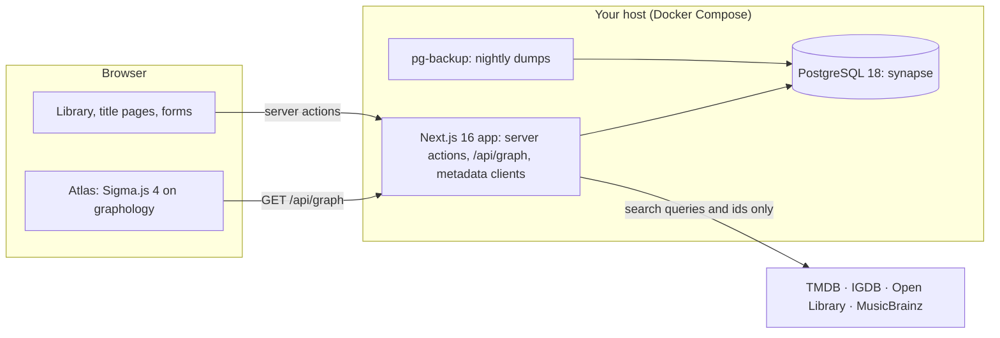

# Synapse Phase 1: Core graph

| Field            | Value                                                                 |
| ---------------- | --------------------------------------------------------------------- |
| Status           | In review                                                             |
| Milestone        | Phase 1: Core graph                                                   |
| Estimated effort | 5 weeks                                                               |
| Depends on       | None. It's the first phase, and it follows the accepted research in #2 |

## 1. Executive summary

Phase 1 builds the core of Synapse: a self-hosted, single-user web app where you add the films,
TV series, games, books, and albums you've lived with, tag them with your own themes, tropes, and
tones, connect them by hand, and log how each one landed. That means a multi-dimensional
resonance score, optional private mood and context, and text key moments. You then see it all
as a graph in the **Atlas** view. A basic **Library** list, a global search, a full JSON export,
and nightly backups make it safe to use every day from the start.

It comes first because every later phase builds on this graph and its data. Imports (Phase 2),
automatic edges (Phase 3), journeys (Phase 4), and insights (Phase 5) add behaviour to the
tables and views made here; they don't reshape them. The stack and the phase order come from the
research on #2, accepted on 2026-11-22. It's recorded in
[ADR 0001](../decisions/0001-self-hosted-nextjs-and-postgresql.md) and
[ADR 0002](../decisions/0002-graph-as-postgres-tables-with-sigma-and-graphology.md).

## 2. Goals and non-goals

### 2.1 Goals

- Run Synapse with one `docker compose up` on your own host, behind sign-in, on the
  finance-stack pattern (ADR 0001).
- Add a title by searching TMDB (film and TV), IGDB (games), Open Library (books), or
  MusicBrainz (albums and artists), or by hand, without ever adding the same title twice.
- Tag titles with free-form themes, tropes, and tones, created inline as you type.
- Draw typed edges between any two nodes by hand, with a weight and a rationale.
- Log each consumption (several per title, for rewatches and replays) with a 0–10 resonance
  score on six dimensions, and optional mood and context that stay private.
- Capture text key moments as nodes that you can search and that appear on the graph.
- See the whole graph in Atlas: a WebGL graph whose clusters are named by their themes, with a
  detail panel, filters, and a stable layout that doesn't reshuffle between visits.
- Browse everything in a sortable, filterable Library list, and find anything with a global
  search.
- Keep the data safe and portable, with nightly database backups and a full JSON export.

### 2.2 Non-goals

- **Imports and sync** from Letterboxd, Goodreads, Steam, Trakt, Spotify, Rate Your Music, PSN,
  or Last.fm, and the Ingest & Capture view. These are Phase 2. Phase 1 has no `listens` or
  `import_runs` tables, and no track or podcast entry.
- **Automatic edges** from metadata credits, the review queue for them, and zooming into
  clusters. These are Phase 3. Phase 1 keeps the credits it fetches in `metadata` for Phase 3 to
  use, but draws no edges from them.
- **Journeys, pathfinding, and Explore** (Phase 4), **Insights and diet analytics** (Phase 5),
  **sharing and other accounts** (Phase 6), and **any AI** (Phase 7, deferred).
- **Phone and tablet layouts.** Phase 1 supports desktop widths of 1024px and up only (§7.4).
- **Screenshot and image moments.** Moments are text only. Images wait until uploads are needed
  elsewhere.
- **Seasons, episodes, editions, and tracks** as nodes. A TV node is a series, a book is a work,
  and an album is a release group.
- **A JSON import or restore.** Restore is from a database backup (1.14). The export is for
  portability, and re-importing it waits for a need.
- **TLS by default and an audit log.** The default posture is a trusted network (ADR 0001). The
  Caddy edge profile from finance-stack can be added when it's needed.

## 3. Architecture impact

Nothing exists yet, so every part is new. The shape copies finance-stack's, which runs the same
stack under the same dev process: PostgreSQL 18.6 in Compose (`finance-stack/docker-compose.yml:29`),
Next.js 16.4.6 with Auth.js 5 beta, Drizzle, and `pg` (`finance-stack/app/package.json:35-40`),
sign-in with no self-registration (`finance-stack/README.md:22`), least-privilege database roles
(`finance-stack/README.md:33`), and a trusted-network default with an optional Caddy edge
(`finance-stack/README.md:37`).

| Part                 | What it is in Phase 1                                                                                                                                                                                                                                         |
| -------------------- | ------------------------------------------------------------------------------------------------------------------------------------------------------------------------------------------------------------------------------------------------------------- |
| `app/`               | Next.js 16 (App Router, TypeScript, Tailwind 4), on port 3002 so it can run beside finance-stack's 3001 (`finance-stack/app/package.json:6`). Mutations are server actions in `app/lib/actions/`, validated with zod in `app/lib/validations/`, mirroring finance-stack. |
| Graph endpoint       | `GET /api/graph` returns every node that Atlas draws and every accepted edge in one compact JSON document, behind sign-in. At Phase 1's scale (hundreds to a few thousand nodes) that's a single request.                                                    |
| Metadata clients     | `app/lib/metadata/`: one `MetadataProvider` interface, four implementations. They run on the server only, so API keys never reach the browser.                                                                                                              |
| `postgres`           | PostgreSQL 18.6, published on loopback only (5433, so it doesn't clash with finance-stack's 5432). Databases `synapse` and `synapse_test`.                                                                                                                    |
| `migrate`            | A one-shot Compose service that creates the roles and applies Drizzle migrations, as finance-stack's does (`finance-stack/docker-compose.yml:84`).                                                                                                           |
| `pg-backup`          | finance-stack's backup service and its `backup.sh` and `restore.sh`, copied (`finance-stack/docker-compose.yml:327`).                                                                                                                                         |
| Browser              | Atlas loads the graph into graphology, runs ForceAtlas2 in a web worker and Louvain communities, and renders with Sigma.js 4 using WebGL (ADR 0002).                                                                                                         |
| CI                   | `.github/workflows/ci.yml` adds lint, typecheck, Vitest (unit and integration, against a Postgres service), and Playwright to the existing `Verify` job, so the ruleset's required check doesn't change.                                                  |

## 4. Resolved design decisions

The stack and the graph storage are in ADR 0001 and ADR 0002, and aren't repeated here.

| Decision                         | Resolution                                                                                                                                                                                                                                       | Rationale                                                                                                                                                                                                                                                      |
| -------------------------------- | ------------------------------------------------------------------------------------------------------------------------------------------------------------------------------------------------------------------------------------------------ | -------------------------------------------------------------------------------------------------------------------------------------------------------------------------------------------------------------------------------------------------------------- |
| Media in Phase 1                 | Film, TV series, game, book, and album, plus artists (`person` or `group`). Albums and artists are searched on MusicBrainz.                                                                                                                       | Music is a medium (the research's revision on #2), and composer and performer links across media are one of Synapse's strongest edges. MusicBrainz is CC0 and needs no key. Its 1 request/s limit is fine for interactive search. Deferring music would leave Atlas missing a medium until Phase 2. |
| Mood and context                 | Logged in Phase 1, optional, on the consumption form. They're stored in their own table, never sent to Atlas, and never shown outside the title's own page.                                                                                        | The table is in the first migration anyway, and capturing mood at the time of consumption can't be done after the fact. Keeping it out of `/api/graph` means later sharing can't leak it by accident.                                                         |
| Themes, tropes, and tones        | Free-form nodes, created inline from an autocomplete while you tag a title. They're unique per type, ignoring case. You can rename and merge them. No starter list is seeded.                                                                     | A seeded taxonomy is opinionated, and it shapes clusters before you've said anything. Merge makes up for the duplicates that free entry creates. Rejected: a seed of about 50 common themes.                                                               |
| Tagging is an edge               | Tagging a title with a theme creates a `tagged` edge (title → theme) with `origin = manual`, `status = accepted`. A theme's kind comes from its node type.                                                                                         | Themes are nodes, so tags pull titles into theme clusters on Atlas with no special case, and Phase 3's review queue and Phase 4's paths treat them like any other edge. Rejected: a separate tags table, which Atlas would have to merge into the graph.      |
| Edge types                       | A fixed set, defined once in `app/lib/graph/edge-types.ts` and enforced by a check constraint: `tagged`, `credit` (the role is in the edge's `metadata`), `adaptation_of`, `sequel_of`, `remake_of`, `in_universe`, `influenced_by`, `spiritual_successor`, `member_of`, `moment_of`, and the undirected `related`. Each type declares which node types it allows at each end. | Typed edges are what make Phase 4's paths and Phase 5's metrics meaningful. A check constraint can be replaced in a later migration, while a Postgres enum can't drop a value. Rejected: user-defined edge types, which fragment the graph; the edge's free-text rationale carries the nuance. |
| Directed edges                   | Edges are stored source → target. `related` is symmetric and is stored once, with the lower id as the source. A unique index on `(source_id, target_id, type)` prevents duplicates.                                                                   | One row per relationship keeps counts and paths honest. A rejected edge keeps its row, so Phase 3 won't suggest it again.                                                                                                                                     |
| Ids                              | `uuid` keys, defaulting to Postgres 18's built-in `uuidv7()`.                                                                                                                                                                                     | They're stable across export and a future import, they don't reveal how many rows exist once sharing arrives in Phase 6, and they sort by time. Rejected: `bigint` identity columns.                                                                          |
| Deduplicating titles             | External ids live in their own `external_ids (node_id, provider, external_id)` table, with `unique (provider, external_id)`. Search results that are already in Synapse are marked, and open the existing node.                                     | A unique constraint enforces it, rather than application code. Phase 2's import matching becomes a lookup. This refines the research's `external_ids jsonb` column. One node can hold ids from several providers.                                              |
| Covers                           | When a title is added, the server downloads one cover at a fixed small size (TMDB `w342`, IGDB `cover_big`, Open Library `-M`, Cover Art Archive `250`) into `node_images` as `bytea`. It's served from the signed-in route `/api/covers/<node-id>`. | The browser never contacts a provider's CDN, so what you look at stays on your host, and the CSP can keep `img-src 'self'`. There's one store to back up (ADR 0002). Rejected: hotlinking, which leaks every title you view; a file volume, which is a second thing to back up. |
| Resonance scale                  | Integers from 0 to 10, each nullable: `rating` overall, plus `emotional`, `intellectual`, `aesthetic`, `revisit`, and `changed_thinking`.                                                                                                          | It's the research's scale. Letterboxd's half stars and Goodreads' five stars both map onto 0–10 without loss in Phase 2. Null means "not logged", which is different from 0.                                                                                  |
| Consumption states               | `planned`, `in_progress`, `paused`, `finished`, `abandoned`. Several consumptions per title. `source = manual` in Phase 1.                                                                                                                        | `planned` covers the backlog without a separate list. Rewatches and replays are separate rows with their own resonance.                                                                                                                                       |
| Moments                          | A `moment` node with its text in `nodes.body`, an optional position (a timestamp, chapter, page, or track) in `metadata`, and a `moment_of` edge to its title. Deleting a title deletes its moments, after a confirmation that shows how many.        | Moments become searchable and visible on the graph, as the pitch asks. Rejected: a moments table, which would need its own search and its own place on the graph.                                                                                             |
| Atlas layout                     | Positions are kept in `node_positions`. Atlas starts ForceAtlas2 from them, places new nodes beside their neighbours, and saves positions after the layout settles. "Re-layout" recomputes from scratch.                                                | An atlas that reshuffles on every visit can't be learned. A separate table means layout writes don't touch `nodes.updated_at`.                                                                                                                               |
| Atlas clusters                   | Louvain communities, computed in the browser. Each one is labelled with its highest-degree theme, trope, or tone, and colour can switch between cluster and medium. Tracks don't exist yet, and moments are hidden unless you turn them on.            | Clusters come from the graph itself, so Phases 1–6 need no AI. Naming a cluster by its central theme gives the "cyberpunk" and "found family" regions the pitch describes.                                                                                    |
| Atlas performance gate           | 1.9's first part loads a generated graph of 10,000 nodes and 30,000 edges, and must hold at least 30 fps while panning and zooming on the owner's desktop. If it can't, the part switches to Cytoscape.js and a new ADR supersedes ADR 0002.          | This is the research's visualization check, on #2, done before any Atlas UI is built on Sigma.                                                                                                                                                                 |
| Search                           | A generated `tsvector` column on `nodes`, built from `title` and `body` with a GIN index, plus `pg_trgm` for fuzzy title matches. Opened with Ctrl+K from anywhere.                                                                                | Postgres does both, with no new service. Moments are found by their text.                                                                                                                                                                                       |
| Export                           | `GET /api/export` downloads one JSON file holding every table except `users`, `node_images` bytes, and `node_positions`. Covers are listed by their source URL. The file has a `format_version` of `1`. A test fails if a new table isn't exported or explicitly excluded. | Your data is yours to take away, private fields included. The test keeps the export complete as later phases add tables.                                                                                                                                      |
| Secrets                          | `TMDB_READ_TOKEN`, `TWITCH_CLIENT_ID`, `TWITCH_CLIENT_SECRET` (for IGDB), `METADATA_CONTACT` (for the MusicBrainz and Open Library User-Agent), `AUTH_SECRET`, and the database passwords, all in `.env`, with placeholders in `.env.example`.          | The repository is public. MusicBrainz blocks clients that don't send a meaningful User-Agent.                                                                                                                                                                  |

## 5. Data model changes

Everything here is new. 1.1 adds `users`. 1.2 adds the graph in one migration, and its issue
spec fixes the column-level details. Later Phase 1 issues add `node_images` (1.4) and
`node_positions` (1.9) as migrations of their own. Each migration ships with its way back.

| Table                 | Purpose and key columns                                                                                                                                                                                                                          |
| --------------------- | ------------------------------------------------------------------------------------------------------------------------------------------------------------------------------------------------------------------------------------------------ |
| `users`               | Auth.js credentials: one owner, created with `npm run auth:create-user`, as in finance-stack.                                                                                                                                                  |
| `nodes`               | `id uuid`, `type` (check: `film`, `tv`, `game`, `book`, `album`, `track`, `podcast`, `person`, `group`, `studio`, `label`, `theme`, `trope`, `tone`, `universe`, `moment`), `title`, `year smallint null`, `body text null`, `metadata jsonb`, `visibility` (`private` by default; `shared` and `public` are reserved for Phase 6), `search tsvector` generated, `created_at`, `updated_at`. `track` and `podcast` are allowed now so that Phase 2 needs no constraint change. A unique index on `(type, lower(title))` applies to `theme`, `trope`, `tone`, and `universe`. |
| `external_ids`        | `node_id → nodes`, `provider` (`tmdb`, `igdb`, `openlibrary`, `musicbrainz`), `external_id`, with `unique (provider, external_id)`.                                                                                                             |
| `edges`               | `id`, `source_id → nodes`, `target_id → nodes`, `type` (check: §4), `weight real` from 0 to 1 (default 0.5), `origin` (`manual`, `metadata`, `import`), `status` (`accepted`, `suggested`, `rejected`), `rationale text null`, `metadata jsonb`, `created_at`. `unique (source_id, target_id, type)`. The research's `created_by_run` arrives with `import_runs` in Phase 2, as a nullable column. |
| `consumptions`        | `id`, `node_id → nodes`, `started_on date null`, `finished_on date null`, `state`, `platform text null`, `source` (`manual`), `created_at`.                                                                                                     |
| `resonance`           | `consumption_id` (primary key, `→ consumptions`), `rating`, `emotional`, `intellectual`, `aesthetic`, `revisit`, `changed_thinking` (each `smallint null`, checked to be 0–10), `note text null`.                                            |
| `consumption_context` | `consumption_id` (primary key), `mood text null`, `context text null`. It's always private: no visibility column, and it's never read by `/api/graph`.                                                                                        |
| `node_images` (1.4)   | `node_id` (primary key), `content_type`, `bytes bytea`, `source_url`, `fetched_at`.                                                                                                                                                             |
| `node_positions` (1.9) | `node_id` (primary key), `x real`, `y real`, `updated_at`.                                                                                                                                                                                     |

All foreign keys to `nodes` cascade on delete. `origin`, `status`, and `visibility` exist from
the first migration, so that Phase 3's review queue and Phase 6's sharing add behaviour without
reshaping stored data (ADR 0002). The app's database role has DML on these tables and no DDL.

## 6. Issue breakdown

| Id   | Issue                            | Description                                                                                                                                                                                                                                                                                                                                                   | Area     | Priority | Size | PRs | Depends on                |
| ---- | -------------------------------- | ------------------------------------------------------------------------------------------------------------------------------------------------------------------------------------------------------------------------------------------------------------------------------------------------------------------------------------------------------------- | -------- | -------- | ---- | --- | ------------------------- |
| 1.1  | App scaffold                     | Compose with `postgres`, `migrate`, and `app`; Next.js 16 with Tailwind and next-themes; least-privilege roles; Auth.js single-user sign-in with `auth:create-user`; the security headers and CSP from `finance-stack/app/lib/security/csp.ts`; lint, typecheck, Vitest, and Playwright in the `Verify` job; npm in Dependabot. It also fills in the stack facts in `CLAUDE.md` and the test levels in `docs/PROCESS.md`. Part 1: Compose, the app shell, roles, and CI. Part 2: sign-in and the security headers. | infra    | P0       | M    | 2   | None                      |
| 1.2  | Data model                       | The first graph migration: `nodes`, `external_ids`, `edges`, `consumptions`, `resonance`, and `consumption_context`, with their checks, indexes, and search column. The Drizzle schema, the edge-type rules in `app/lib/graph/edge-types.ts`, and integration tests for every constraint.                                                                   | database | P0       | M    | 1   | 1.1                       |
| 1.3  | Titles by hand                   | Add, edit, and delete a title (film, TV, game, book, album) or an entity (person, group, studio, label, universe) by hand. The title page at `/nodes/[id]`, which later becomes Atlas's detail panel too. The app's navigation: Atlas, Library, Add.                                                                                                       | ui       | P0       | M    | 1   | 1.2                       |
| 1.4  | Add titles by search             | The `MetadataProvider` interface; TMDB, IGDB, Open Library, and MusicBrainz clients, throttled to each provider's limit; the `node_images` migration and the covers route; marking results that are already in Synapse; provider attribution on `/about`. Part 1: the interface, covers, TMDB, and Open Library. Part 2: IGDB and MusicBrainz.          | api      | P0       | M    | 2   | 1.3                       |
| 1.5  | Themes, tropes, and tones        | Tag a title inline from an autocomplete that creates new themes, tropes, and tones; remove tags; a page per theme that lists its titles; rename; merge one into another, which re-points its edges in one transaction.                                                                                                                                      | ui       | P0       | M    | 1   | 1.3                       |
| 1.6  | Manual edges                     | Connect any two nodes from a title page: pick the target with search, then the type (only the types valid for those two node types are offered), the weight, and a rationale. List, edit, and delete a node's edges. A `credit` edge asks for the role.                                                                                                     | ui       | P0       | M    | 1   | 1.3                       |
| 1.7  | Consumption and resonance logging | Log a consumption from a title page: its state, dates, and platform; the six 0–10 resonance dimensions and a note; optional private mood and context. Several consumptions per title, each editable and deletable.                                                                                                                                      | ui       | P0       | M    | 1   | 1.3                       |
| 1.8  | Key moments                      | Add, edit, and delete a text moment (a quote or a note, with an optional position) on a title; it's shown on the title page, newest first.                                                                                                                                                                                                                  | ui       | P1       | S    | 1   | 1.3                       |
| 1.9  | Atlas                            | `GET /api/graph`, then the Atlas view at `/`: Sigma and graphology, ForceAtlas2 in a worker, the `node_positions` migration, Louvain clusters named by theme, colour by cluster or medium, select a node to open the detail panel, and the empty state. Part 1: the endpoint, a seed script for 10,000 nodes, and the performance gate (§4), with its result in the PR. Part 2: the Atlas UI. | ui       | P0       | M    | 2   | 1.2; 1.5 and 1.6 for real data |
| 1.10 | Atlas filters and focus          | Filter Atlas by medium and node type, show or hide moments, search for a node to fly the camera to it and select it, and re-layout.                                                                                                                                                                                                                       | ui       | P1       | S    | 1   | 1.9                       |
| 1.11 | Library                          | `/library`: a table of titles (TanStack Table, as in finance-stack) with cover, medium, year, latest state, and overall rating, sortable, and filterable by medium, state, rating, and theme.                                                                                                                                                              | ui       | P1       | S    | 1   | 1.7                       |
| 1.12 | Global search                    | A Ctrl+K palette that searches every node by title and body (full text plus fuzzy title match), grouped by type, and opens the result.                                                                                                                                                                                                                   | api      | P1       | S    | 1   | 1.3; moments once 1.8 lands |
| 1.13 | JSON export                      | `GET /api/export` and a button on `/settings` that downloads the export (§4), with the completeness test.                                                                                                                                                                                                                                                 | api      | P1       | S    | 1   | 1.2                       |
| 1.14 | Database backups                 | The `pg-backup` service, with `backup.sh` and `restore.sh`, nightly dumps with retention, and a documented, tested restore.                                                                                                                                                                                                                               | infra    | P0       | S    | 1   | 1.1                       |
| 1.15 | Home stats strip                 | A strip on Atlas with counts by medium, the titles in progress, and the last five consumptions.                                                                                                                                                                                                                                                     | ui       | P2       | S    | 1   | 1.7, 1.9                  |

1.1 and 1.2 land first, and everything else depends on them. After 1.3, issues 1.4 to 1.8 don't
depend on one another and can go in any order. 1.9's first part can start as soon as 1.2 merges.
That's 15 issues and 18 PRs. Eight M issues and seven S issues come to about 31 working days at
most, or about five weeks. That's a week more than the research's estimate, because music
search, covers, and backups were added.

## 7. UI and UX specifications

### 7.1 Visual language

- Tailwind 4 with light, dark, and system themes through next-themes, as finance-stack has
  (`finance-stack/app/package.json:39`). Colours are tokens, so Atlas's palette is defined once
  for both themes.
- Each medium has one colour and one icon, and both are used everywhere: in Atlas, in the
  Library, and on the title pages. Atlas never uses colour alone; the detail panel and tooltips
  name the medium.
- Cluster colours come from a fixed categorical palette of eight colours, checked for contrast
  against both theme backgrounds. Any further clusters reuse the palette with labels.

### 7.2 Flows

- **First run:** sign in, then an empty Atlas that says what it will show, with one button:
  "Add your first title".
- **Add a title:** Add, then choose a medium, type to search (results appear as you type,
  debounced to 300ms, with already-added titles marked), pick one, and land on its new title
  page. "Can't find it? Add by hand" is always offered, and so is a fallback when a provider is
  down.
- **On a title page:** tag themes, add an edge, log a consumption, and add a moment, each in a
  dialog that returns to the page with the change in place.
- **Atlas:** click a node to open the detail panel (the title page's content, condensed), and
  press Escape to close it. Ctrl+K works everywhere.

### 7.3 States

- **Empty:** Atlas, the Library, a theme with no titles, and a title with no consumptions each
  say what's missing and offer the action that fills it.
- **Loading:** Atlas shows a progress note while the graph loads and the layout settles. Lists
  show skeleton rows.
- **Errors:** a provider error, timeout, or rate limit shows "TMDB isn't responding" with a
  retry, and keeps "Add by hand" available. A failed save keeps the form's input and says why.
  WebGL being unavailable shows a message that points to the Library.

### 7.4 Sizes, keyboard, and motion

- **Desktop only:** 1024px wide and up. Layouts are checked at 1024px and 1920px. Below 1024px
  nothing is deliberately hidden, but nothing is promised either.
- **Keyboard:** every action except dragging in Atlas has a keyboard path. Tab order follows the
  page, dialogs trap focus and give it back on close, and Ctrl+K and Escape work everywhere. In
  Atlas, search (1.10) is the keyboard way to reach a node, and the detail panel is ordinary,
  focusable HTML.
- **Reduced motion:** with `prefers-reduced-motion`, Atlas runs the layout to convergence before
  showing it, and camera moves are instant instead of animated.
- **Screen readers:** the Atlas canvas has a text summary (the counts and the largest clusters)
  and a link to the Library, which holds the same data as a table.

## 8. Testing strategy

| Level              | Tool                                    | Covers                                                                                                                                                                                                     |
| ------------------ | --------------------------------------- | ---------------------------------------------------------------------------------------------------------------------------------------------------------------------------------------------------------- |
| Static             | ESLint, `tsc`, the process check        | Every PR, in the `Verify` job.                                                                                                                                                                              |
| Unit               | Vitest                                  | zod schemas, the edge-type rules, resonance ranges, the provider response mappers (from recorded fixtures), cluster naming, and the export's shape.                                                        |
| Component          | Vitest with jsdom                       | The logging, tagging, and edge forms: validation messages, autocomplete, focus return.                                                                                                                     |
| Integration        | Vitest against `synapse_test` in Postgres | Migrations up and down, every constraint in §5, theme merge, cascading deletes, search ranking, `/api/graph` never including `consumption_context`, and export completeness.                             |
| End to end         | Playwright                              | Sign in; add a title by hand; tag a theme; add an edge; log resonance and mood; see the node in Atlas and open its panel; filter the Library; search for a moment; download the export.                     |
| Manual             | By hand, recorded in the PR             | A live search smoke test per provider (CI never calls a live API); the Atlas performance gate (1.9); a backup restored into a scratch database (1.14).                                                    |

Release QA matrix: Chrome and Firefox on Windows, each in the light and dark themes, at 1024px
and 1920px, with keyboard only and with reduced motion on.

## 9. Open questions

None block Phase 1. These are deferred:

- **Sigma or Cytoscape:** settled by the performance gate in 1.9's first part. If Sigma fails,
  that part supersedes ADR 0002.
- **Hierarchical layouts:** the pitch asks for them, but Phase 1 needs only force-directed
  layouts. They're revisited with cluster zoom in Phase 3, which is where ADR 0002 says to look
  again.
- **Reaching Synapse away from home:** a VPN such as Tailscale, or the Caddy edge profile. This
  is decided in Phase 2, where Spotify's OAuth redirect needs HTTPS or a loopback address
  anyway (#2).
