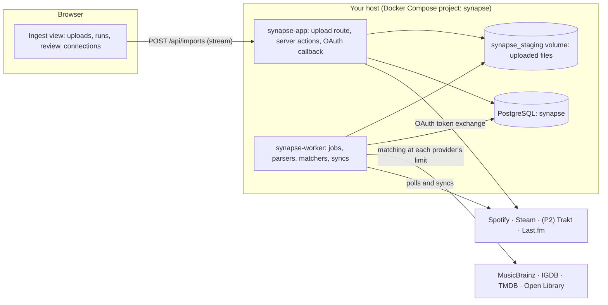
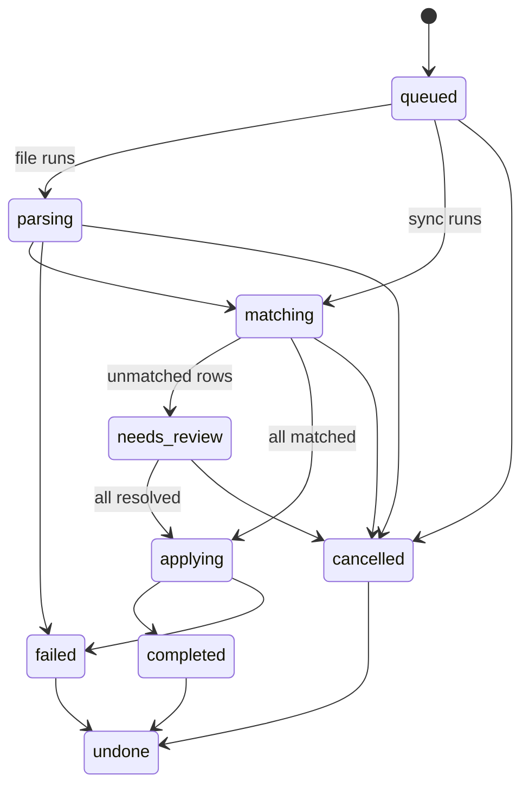

# Synapse Phase 2: Ingestion

| Field            | Value                                                                       |
| ---------------- | --------------------------------------------------------------------------- |
| Status           | Draft                                                                       |
| Milestone        | Phase 2: Ingestion                                                          |
| Estimated effort | 5 weeks for P0 and P1, 7 with every P2                                      |
| Depends on       | Phase 1, and the accepted research in #25                                   |

## 1. Executive summary

Phase 2 fills the graph from the places you already keep your history, so you don't have to
type it in by hand. Synapse:

- imports your lifetime Spotify listening history and your Rate Your Music ratings from their
  export files;
- keeps listening up to date by polling Spotify;
- syncs your Steam library and playtime.

Every import shows up as an **import run** in a new **Ingest** view. You see its progress there,
and you resolve the rows it couldn't match in a review queue before they reach the graph. You
can undo a run that went wrong. A background worker does the slow work: parsing exports of a
hundred megabytes or more, and matching thousands of albums against MusicBrainz at one request a
second.

The film, TV, and book sources are here too, at P2: Letterboxd, Trakt, Goodreads, and Last.fm
as a fallback for ongoing plays. The owner uses Steam, Spotify, and Rate Your Music, so those
come first.

It comes after Phase 1 because it writes into Phase 1's tables through Phase 1's paths. Imported
titles are added the way a search result is (1.4, 1.5). Every edge goes through `validateEdge`
(Phase 1 §3.2). Every table is covered by the export's completeness test (1.16). It comes before
Phase 3 because automatic credit edges need real data to be worth reviewing. Phase 3 reads the
credits that Phase 1 and Phase 2 keep in `metadata`.

## 2. Goals and non-goals

### 2.1 Goals

- Run imports and syncs in a `synapse-worker` service. Its job queue lives in Postgres, it
  retries failed jobs, and Synapse shows whether it's alive.
- Upload an export file from the browser. Each upload becomes an import run with its progress,
  its counts, and its errors. Uploading the same file twice adds nothing new.
- Match each imported row to a metadata id automatically when the match is unambiguous.
  Otherwise the row waits in a review queue, where you pick a candidate, search again, add the
  title by hand, or skip it. You can act on many rows at once.
- **Spotify history:** import the extended streaming history as plays. Each play is stored
  against a track node, or against a podcast node for an episode. An album joins the graph once
  you've listened to it enough (§4), matched to its MusicBrainz release group.
- **Spotify polling:** connect a Spotify account over OAuth with PKCE, and poll recently played
  every 30 minutes. Synapse warns you before the connection's six-month deadline, and flags gaps
  in the polled plays.
- **Rate Your Music:** import your RYM ratings and reviews onto albums matched in MusicBrainz.
  The rating becomes the overall resonance score, and the review becomes the private note.
- **Steam:** sync the games you own and their playtime once a day, matched to IGDB through
  Steam's app ids. Synapse keeps a history of playtime for Phase 5.
- Keep tokens encrypted at rest. Disconnecting a service deletes its token.
- Show listening on the album, track, and podcast pages, and in the Library.
- Undo an import run, after a confirmation that shows the counts of what it will remove.
- **P2:** Letterboxd, Trakt, and Goodreads imports, Last.fm plays, and a quick Capture form for
  platforms that have no import.

### 2.2 Non-goals

- **PlayStation and Xbox.** PSN's only route is an unofficial cookie-token API, and Xbox's needs
  a third-party proxy (#2). Both wait for a later phase. Capture (2.16) is the way in meanwhile.
- **stats.fm** (#2): its API is undocumented, and its data is Spotify's own.
- **Scraping Rate Your Music** for genres or descriptors. RYM's terms forbid it. Only your own
  export is read.
- **Automatic edges** from imported credits, such as artist and label credits. Credits are kept
  in `metadata`, as Phase 1 does (Phase 1 §2.2), and Phase 3 draws edges from them. Phase 2
  draws only `track_of` edges (§5.1).
- **Tracks and podcasts on Atlas.** `/api/graph` already leaves out `track` and `podcast` nodes
  (Phase 1 §3.3), and that doesn't change. Episodes aren't nodes.
- **Two-way sync.** Synapse never writes to Spotify, Steam, Trakt, or any other service.
- **Importing Letterboxd tags and Goodreads shelves as themes.** That would seed the taxonomy
  that Phase 1 chose not to seed (Phase 1 §4). Each P2 issue's spec decides what happens to them.
- **Phone layouts and down migrations**, as in Phase 1 (Phase 1 §2.2).
- **Rotating the encryption key.** Changing `SYNAPSE_ENCRYPTION_KEY` marks every connection as
  needing reconnection. The ciphertext carries a version byte (§4), so rotation can be added
  later.
- **Reaching Synapse away from home.** It stays a VPN or the Caddy edge profile (ADR 0001). Phase
  1 deferred the choice here only because of Spotify's redirect rule, and the loopback redirect
  (§4) settles that.

## 3. Architecture impact

### 3.1 Services

| Service           | Container name          | What changes                                                                                                                                                                                                                                                                                                                                                                                                                          |
| ----------------- | ----------------------- | ------------------------------------------------------------------------------------------------------------------------------------------------------------------------------------------------------------------------------------------------------------------------------------------------------------------------------------------------------------------------------------------------------------------------------------- |
| `worker` (new)    | `synapse-worker`        | Runs from the app image with `node worker.js`. It publishes no port. It connects as a new `synapse_worker` role (§5), mounts `synapse_staging`, and has a heartbeat healthcheck, as finance-stack's importer does (`finance-stack/docker-compose.yml:269-306`). It writes its heartbeat to `worker_heartbeats` as well as to a file, so the Ingest view can show "The worker hasn't checked in for 12 minutes". It has memory limits like the importer's. |
| `app`             | `synapse-app`           | It gains the upload route and the OAuth routes, and mounts `synapse_staging` read-write. The upload route is left out of the Next.js 16 `proxy` matcher. A route that `proxy` matches has its body buffered in memory ([proxyClientMaxBodySize](https://nextjs.org/docs/app/api-reference/config/next-config-js/proxyClientMaxBodySize)).                                                                              |
| `migrate`         | `synapse-migrate`       | It creates the `synapse_worker` role and applies Phase 2's migrations.                                                                                                                                                                                                                                                                                                                                                                 |
| `pg-backup`       | `synapse-pg-backup`     | It doesn't change. The new tables are in the dump. The staging volume isn't backed up, because a staged file is deleted once it's parsed.                                                                                                                                                                                                                                                                                                  |

**Why a worker container, and not an in-process timer:** finance-stack runs its recurring
transactions on a timer inside the app process (`finance-stack/app/lib/recurring/scheduler.ts:10-13`,
started from `finance-stack/app/instrumentation.ts:18`). That's right for an hourly job that
takes milliseconds. It isn't right for parsing a Spotify export of 100 MB or more, or for an hour
of MusicBrainz matching: both would share the web process's event loop and memory with page
requests. pg-boss was rejected because it creates its own schema at startup, and the app's
roles have no DDL (Phase 1 §5).

### 3.2 The app and the worker

- **Jobs:** the queue is the `jobs` table (§5). The worker claims a job with
  `SELECT … FOR UPDATE SKIP LOCKED`, runs it, and records the result.
  - A job that fails is retried with backoff (1, 5, then 30 minutes), up to five attempts, and
    is then marked `failed`, with its error shown on its run.
  - A job still `running` after 15 minutes without a heartbeat goes back in the queue.
  - Recurring syncs are jobs too. The worker enqueues the next one itself, and a unique partial
    index on `(kind) WHERE status IN ('queued', 'running')` keeps at most one of each sync kind
    waiting or running.
- **Importers:** each source implements one interface in `app/lib/import/`, with an
  implementation in `app/lib/import/sources/<source>.ts`. The interface has three steps:
  - `parse(file | sync)` turns the file or the sync into rows;
  - `match(row)` finds candidates through the Phase 1 `MetadataProvider`s;
  - `apply(row, resolution)` writes nodes, consumptions, listens, and playtime in one
    transaction per row, each tagged with its `created_by_run`.

  Applying a matched row adds a title by the same path as adding a search result (1.4): the
  external id deduplicates, and the cover is fetched with the same checks.
- **Throttles shared between processes:** Phase 1's per-provider throttles live in the app
  process's memory (Phase 1 §4, Search-as-you-type). With a worker making requests too,
  MusicBrainz would get two requests a second and answer 503. 2.1 moves the throttle into
  Postgres:
  - There's one `provider_slots` row per provider.
  - A request reserves the next slot with
    `UPDATE … SET next_slot_at = greatest(now(), next_slot_at) + interval RETURNING`, then waits
    for it.
  - The worker never reserves a slot more than two seconds ahead, so a search you type waits
    behind at most two of the worker's requests.
- **Uploads:** `POST /api/imports` checks the sign-in session. It refuses a request whose
  `Origin` isn't Synapse's own, and refuses bodies over 1 GB. It streams the body to
  `synapse_staging/<run-id>`, computing its SHA-256 as it goes, then creates the run and its
  `parse_file` job.
- **Archives:** ZIP files are read with `yauzl` as a stream, entry by entry. Nothing is ever
  extracted to a path taken from an entry's name, so a hostile archive can't write outside the
  staging volume. Only the entries a source expects are read. Reading stops at 4 GB uncompressed
  or 10,000 entries. CSV files are read with `csv-parse`. Both are new dependencies, pinned in
  the issue that adds them.
- **Untrusted content:** every row is validated with zod in `app/lib/validations/import/`, and
  its strings are capped (titles at 500 characters, review text at 20,000). React renders them
  as text. The staged file is deleted when parsing finishes, whether it succeeded or failed.

### 3.3 Interfaces

These carry exactly the keys listed. Tests assert each key set, as in Phase 1 §3.3.

| Interface                                         | Shape                                                                                                                                                                                                                                                                                                                                                                         |
| ------------------------------------------------- | ----------------------------------------------------------------------------------------------------------------------------------------------------------------------------------------------------------------------------------------------------------------------------------------------------------------------------------------------------------------------------- |
| `POST /api/imports?source=<source>` (2.2)         | The body is the file's bytes, with the file name in `X-File-Name`. It answers 202 with `{ runId, previousRunId }`. `previousRunId` is set when a file with the same SHA-256 was imported before, so the UI can say "Imported on 3 March; importing again adds only what's new". It answers 413 over the size cap, and 415 when the file doesn't look like the source's export. |
| `GET /api/imports` and `GET /api/imports/<id>` (2.2) | `{ id, source, status, counts: { rows, matched, needsReview, applied, skipped, failed, duplicates }, progress: { done, total }, gaps: [{ from, to }], error, createdAt, startedAt, finishedAt }`. The list returns the newest 50. The Ingest view polls one run every 5 seconds while it's active.                                                                      |
| `GET /api/imports/<id>/review?cursor=` (2.3)      | `{ rows: [{ id, summary: { type, title, year, creator }, candidates: [{ source, externalId, type, title, year, subtitle, existingNodeId }] }], nextCursor }`. There are at most five candidates, in the shape of Phase 1's search results (Phase 1 §3.3). `summary` never holds a review, a rating, or a note.                                                                     |
| Server actions (2.3, 2.10)                        | `resolveImportRows(runId, rowIds, resolution)`, where `resolution` is `{ kind: "candidate", source, externalId }`, `{ kind: "node", nodeId }`, `{ kind: "manual", title, year }`, `{ kind: "topCandidate" }` (bulk only), or `{ kind: "skip" }`. Also `cancelImportRun(runId)` and `undoImportRun(runId)`.                                                                    |
| Connections (2.4, 2.5, 2.7)                       | `GET /api/connections/spotify/start` answers 302 to Spotify's authorize URL. `GET /api/connections/spotify/callback?code=&state=` checks `state` against an httpOnly cookie, then exchanges the code. Server actions: `saveSteamAccount(steamId)`, `disconnect(provider)`, and `syncNow(provider)`. Connection rows sent to the browser are `{ provider, status, accountLabel, authorizedAt, reauthBy, lastSyncAt, lastError }` and never hold a token. |
| Library rows (1.14, changed by 2.9)               | Gain `plays` (a number, or null for media that aren't music) and `listeningMinutes`. The exact-keys test changes with them.                                                                                                                                                                                                                                                  |
| `GET /api/export` (1.16, changed by 2.2 onward)   | `format_version: 2`. It adds `import_runs` (without the raw rows), `listens`, and `playtime_snapshots`. `connections`, `import_rows`, `jobs`, `provider_slots`, and `worker_heartbeats` are explicitly excluded. Credentials and staging data aren't yours to carry away; they're Synapse's working state.                                                                       |

## 4. Resolved design decisions

The research on #25 compared the options, and its note has the evidence. The owner accepted
these on 2026-11-23.

| Decision                          | Resolution                                                                                                                                                                                                                                                                                                                                                                                                                                                                                                                                                                                                                                                                                                                                                                                                                                                                                                                                       | Rationale                                                                                                                                                                                                                                                                                                                                                                                                                          |
| --------------------------------- | -------------------------------------------------------------------------------------------------------------------------------------------------------------------------------------------------------------------------------------------------------------------------------------------------------------------------------------------------------------------------------------------------------------------------------------------------------------------------------------------------------------------------------------------------------------------------------------------------------------------------------------------------------------------------------------------------------------------------------------------------------------------------------------------------------------------------------------------------------------------------------------------------------------------------------------------------------------------------------- | ---------------------------------------------------------------------------------------------------------------------------------------------------------------------------------------------------------------------------------------------------------------------------------------------------------------------------------------------------------------------------------------------------------------------------------- |
| Source priority                   | P0: Spotify history, Spotify polling, and Steam. P1: Rate Your Music. P2: Letterboxd, Trakt, Goodreads, Last.fm, and Capture.                                                                                                                                                                                                                                                                                                                                                                                                                                                                                                                                                                                                                                                                                                                                                                                                                                                                     | These are the sources the owner uses. The importer interface (§3.2) means a P2 source is one file, a fixture, and its rows in the review UI.                                                                                                                                                                                                                                                                                      |
| Background work                   | A `synapse-worker` container, with a `jobs` table claimed with `SKIP LOCKED` (§3.1, §3.2).                                                                                                                                                                                                                                                                                                                                                                                                                                                                                                                                                                                                                                                                                                                                                                                                                                                                                                        | It keeps long parses and an hour of matching out of the web process, and adds no dependency. Rejected: the in-process timer, and pg-boss (§3.1).                                                                                                                                                                                                                                                                                 |
| The review queue                  | A row is matched automatically only when exactly one candidate has the same normalized title (case, punctuation, a leading "The", and edition suffixes such as "(Deluxe)" are ignored), the same normalized primary creator, and a year within one either way (or no year on either side). Every other row waits in its run's review queue, and nothing it would create reaches the graph until you resolve it. The queue offers candidates, search again, add by hand (prefilled), and skip, each on one row or on a selection. | You chose this. A wrong automatic match is worse than a question: it puts a node on Atlas with your rating on it. Bulk actions keep a queue of hundreds of rows workable.                                                                                                                                                                                                                                                         |
| What lands without review         | Plays, and the track and podcast nodes they're stored against. Neither is on Atlas, and a Spotify track URI is an exact id (`spotify_track` in `external_ids`). Podcasts have no provider in Synapse, so a show becomes a `podcast` node keyed by its show URI (`spotify_show`).                                                                                                                                                                                                                                                                                                                                                                                                                                                                                                                                                                                                                                                                                                                       | Listening facts shouldn't wait on a queue. Albums, which are on Atlas, are what you review.                                                                                                                                                                                                                                                                                                                                       |
| When an album joins the graph     | An album you've listened to through Spotify becomes a candidate once it reaches 30 minutes of listening, or five plays of at least two different tracks. Candidates are matched to MusicBrainz release groups. Below the threshold, the plays stay on their track nodes, with the album's name in the track's `metadata`. The album is promoted when a later import or poll takes it over the threshold. An album rated in RYM, or added by you, needs no threshold.                                                                                                                                                                                                                                                                                                                                                                                                                                                                     | A lifetime history holds thousands of albums heard once from a playlist. Putting each on Atlas would bury the ones you know, and matching them would take hours at one request a second. The 2.6 spec tunes the numbers against the owner's real history.                                                                                                                                                                         |
| Spotify matching                  | **History:** the export gives track, album, and artist names, and track URIs, but no album id. So each candidate album is matched with a MusicBrainz release-group search by artist and title. **Polls:** these return the album's Spotify id. So Synapse tries MusicBrainz's URL lookup (`/ws/2/url?resource=https://open.spotify.com/album/<id>&inc=release-rels`) first, and falls back to search. Tracks are never matched to MusicBrainz.                                                                                                                                                                                                                                                                                                                                                                                                                                                                                                                                       | One search per album, not per track, keeps a lifetime history to about one to one and a half hours of matching at MusicBrainz's 1 request a second ([rate limiting](https://musicbrainz.org/doc/MusicBrainz_API/Rate_Limiting)). Spotify removed the batch `GET /tracks` for new Development Mode apps ([Feb 2026](https://developer.spotify.com/documentation/web-api/references/changes/february-2026)), so looking up ISRCs track by track isn't affordable. |
| Plays                             | A play is a row in `listens`. Plays under 30 seconds are dropped, which is Spotify's own threshold for a stream. Re-importing the same source is deduplicated by `unique (source, source_ref)`. For an export play, `source_ref` is its `ts` and track URI. For a poll, it's its `played_at` and track URI. A polled play and an export play of the same track are the same play when the export's end time falls between the poll's `played_at` minus 10 seconds and `played_at` plus the track's duration plus 10 seconds. The first one stored is kept. | Exports and polls overlap by design: a fresh export fills a gap in the polls. The window is right whether `played_at` marks the start of a play or its end, so it doesn't depend on behaviour Spotify doesn't document.                                                                                                                                                                                                                |
| Spotify connection                | A personal Development Mode app, with OAuth Authorization Code and PKCE. The redirect is `http://127.0.0.1:3002/api/connections/spotify/callback` (`SPOTIFY_REDIRECT_URI`). If you open Connect from any other address, Synapse explains: open Synapse at `http://127.0.0.1:3002` on the host, or tunnel to it with `ssh -L 3002:127.0.0.1:3002 <host>`. The scopes are `user-read-recently-played` only. Synapse stores `authorized_at` and shows `reauthBy` (six months later). It warns on the Ingest view from 14 days before that date, and on a `400 invalid_grant` it marks the connection `needs_reauth` and stops polling. When a refresh returns a new refresh token, Synapse stores it. | Spotify accepts only HTTPS or `http://127.0.0.1:PORT` redirects ([redirect URIs](https://developer.spotify.com/documentation/web-api/concepts/redirect_uri)). Refresh tokens expire six months after authorization, and refreshing doesn't extend them ([2026-06-18](https://developer.spotify.com/blog/2026-06-18-refresh-token-expiration)), so reconnecting is routine and has to be easy. The loopback redirect keeps the trusted-network default (ADR 0001). Rejected: the Caddy edge profile or Tailscale HTTPS only for this. |
| Spotify polling                   | Every 30 minutes, `GET /me/player/recently-played?limit=50&after=<newest stored>`. If the oldest play returned is newer than the newest stored, plays in between may be lost, and the gap is recorded on the run and shown on the Ingest view, with the advice that a new extended export fills it. A 429 waits for `Retry-After`. A 429 whose `reason` is `QUOTA_EXCEEDED` pauses polling for six hours.                                                                                                                                                                                                                                                                                                                                                                                                                                                                                                                                                   | The endpoint returns at most 50 tracks ([reference](https://developer.spotify.com/documentation/web-api/reference/get-recently-played)), which is about three hours of continuous listening. Quota is counted per developer account ([2026-07-23](https://developer.spotify.com/blog/2026-07-23-web-api-quota-updates)).                                                                                                                |
| Trakt connection (P2)             | OAuth's device-code flow (`/oauth/device/code`): Synapse shows a code, and you enter it at trakt.tv. Status 418 means slow down, and 410 means the code was denied.                                                                                                                                                                                                                                                                                                                                                                                                                                                                                                                                                                                                                                                                                                                                                                                                                         | It needs no redirect at all, so it works from any address on the trusted network.                                                                                                                                                                                                                                                                                                                                                 |
| Steam                             | `STEAM_API_KEY` goes in `.env`, and you enter your SteamID64 on the Ingest view. A daily sync calls `IPlayerService/GetOwnedGames` with `include_appinfo`, and looks up the IGDB game through `external_games` by Steam app id, batched. A game with at least 30 minutes of playtime gets a consumption (`source = steam`, `state = in_progress`) if it has none yet. Synapse never changes or adds a consumption after that, so a state you set stays. Every sync appends a `playtime_snapshots` row for each game whose minutes changed. A game under 30 minutes is listed as skipped on the run, with "Import anyway".                                                                                                                                                                                                                                                                                                                                                                                  | Steam gives only cumulative playtime, not sessions. Snapshots let Phase 5 chart play time over time. A consumption gives the game a Library state without overriding what you log by hand. A backlog of unplayed bundle games would bury the ones you've played.                                                                                                                                                                   |
| Rate Your Music                   | You upload the CSV from `rateyourmusic.com/musicexport`. Each rated row becomes a consumption (`source = rym`, `state = finished`) on the matched album. The rating goes to `resonance.rating` on 0–10, and the review to `resonance.note`, which is private (Phase 1 §4). The RYM release id is stored as `rym_release`. Rows are matched by artist, title, and year through MusicBrainz release-group search. The columns and the rating scale are checked against a real export in 2.8 (§9).                                                                                                                                                                                                                                                                                                                                                                                                                                                                                             | RYM has no API, and only your own export may be read (#2). The note is as private as a note written by hand.                                                                                                                                                                                                                                                                                                                    |
| Imported ratings                  | Converted to Phase 1's 0–10 scale (Phase 1 §4, Resonance scale) without rounding: Letterboxd and RYM half stars are doubled, Goodreads stars are doubled, and Trakt's 1–10 is kept as it is. Only `rating` is filled in. The other five dimensions stay null.                                                                                                                                                                                                                                                                                                                                                                                                                                                                                                                                                                                                                                                                                                                            | Every one of these scales maps onto 0–10 exactly. Null means "not logged" (Phase 1 §4).                                                                                                                                                                                                                                                                                                                                            |
| Tokens at rest                    | AES-256-GCM with `node:crypto`, keyed by `SYNAPSE_ENCRYPTION_KEY` (32 bytes, base64, in `.env`). The stored form is `version (1 byte) ‖ IV (12 bytes) ‖ ciphertext ‖ tag (16 bytes)`, with the provider name as additional authenticated data, so a ciphertext can't be moved to another connection's row. If decryption fails, the connection becomes `needs_reauth`. Tokens are never logged, never sent to the browser, never exported, and disconnecting deletes them. Provider app credentials (`SPOTIFY_CLIENT_ID`, `STEAM_API_KEY`, and at P2 `TRAKT_CLIENT_ID`, `TRAKT_CLIENT_SECRET`, `LASTFM_API_KEY`) stay in `.env`, as TMDB's does (Phase 1 §4, Secrets).                                                                                                                                                                                                                                                                                                                                              | A database backup alone doesn't give away your accounts. Losing the key costs a reconnect, not data. GCM is authenticated encryption in Node's standard library, so there's no new dependency. The `.env` file has to be backed up beside the dumps, and the 2.4 README says so.                                                                                                                                              |
| Worker privileges                 | A new `synapse_worker` role has `SELECT`, `INSERT`, and `UPDATE` on the tables it writes, and no `DELETE` except on `jobs`, `import_rows`, and `worker_heartbeats`. Undoing a run, disconnecting, and every other delete happen in the app.                                                                                                                                                                                                                                                                                                                                                                                                                                                                                                                                                                                                                                                                                                                                                  | A bad parser can add rows that an undo removes, but it can't destroy data you entered. This mirrors finance-stack's append-only importer role (`finance-stack/docker-compose.yml:281-284`).                                                                                                                                                                                                                                       |
| Undoing a run                     | Undo removes everything with that `created_by_run`: listens, playtime snapshots, consumptions with their resonance, and `track_of` edges. It also removes the nodes the run created, unless something else now refers to them: an edge from elsewhere, a consumption, a moment, or a play from another run. Those nodes are kept, and counted in the confirmation. Undo happens in one transaction.                                                                                                                                                                                                                                                                                                                                                                                                                                                                                                                                                                                    | Imports write a lot at once. One button that reverses a bad one, without touching anything you've added since, is what makes it safe to try a new source.                                                                                                                                                                                                                                                                      |
| Raw rows                          | `import_rows.raw` holds the parsed row until its run finishes and 30 days pass, or until the run is undone. A daily job then deletes it. Counts and resolutions stay on the run.                                                                                                                                                                                                                                                                                                                                                                                                                                                                                                                                                                                                                                                                                                                                                                                                | Raw rows can hold private review text, so they shouldn't outlive their purpose. Thirty days leaves time to review and undo.                                                                                                                                                                                                                                                                                                      |
| Export                            | Each issue that adds a table adds it to the export or to its exclusion list, so 1.16's completeness test keeps passing. `format_version` goes to `2` with the first exported table, in 2.2 (§3.3).                                                                                                                                                                                                                                                                                                                                                                                                                                                                                                                                                                                                                                                                                                                                                                                                | The completeness test fails otherwise. Bumping the version says plainly that the shape changed.                                                                                                                                                                                                                                                                                                                                  |
| Provider base URLs                | Every provider's base URL is read from configuration with the real default (`SPOTIFY_API_BASE`, `MUSICBRAINZ_BASE`, and so on). End-to-end tests point them at a fake provider in the test Compose file.                                                                                                                                                                                                                                                                                                                                                                                                                                                                                                                                                                                                                                                                                                                                                                                 | CI never calls a live API (Phase 1 §8), but the worker's full path still has to be tested end to end.                                                                                                                                                                                                                                                                                                                            |
| What leaves the host              | Phase 2 adds these to what Phase 1 sends out: • **MusicBrainz:** the artist and album names of albums past the threshold, and of RYM rows. • **IGDB:** Steam app ids. • **Spotify and Steam:** your OAuth codes and account ids. Every metadata request carries the `METADATA_CONTACT` User-Agent, as in Phase 1. | These are searches that you'd otherwise have typed yourself. Nothing private is ever sent: no ratings, notes, mood, or context.                                                                                                                                                                                                                                                                                                  |
| Navigation                        | 2.2 adds **Ingest** (`/ingest`) to the navigation. Each source adds its own card to the Ingest view when it lands.                                                                                                                                                                                                                                                                                                                                                                                                                                                                                                                                                                                                                                                                                                                                                                                                                                                                    | `main` stays releasable between any two issues (Phase 1 §4, Navigation).                                                                                                                                                                                                                                                                                                                                                         |

## 5. Data model changes

Each issue brings its own forward-only migration, and each release declares its `Migration:`
marker (Phase 1 §5). Every change below is additive, so existing data needs no backfill. The
`Migration:` marker is `backward-compatible` for every Phase 2 release, because the previous
version ignores the new tables and columns. Every new foreign key to `nodes` cascades, as in
Phase 1. Every `created_by_run` column is `→ import_runs`, nullable, and set to null on delete.

| Table or change                  | Issue | Purpose and key columns                                                                                                                                                                                                                                                                                                                                                                                                                                                                                       |
| -------------------------------- | ----- | ------------------------------------------------------------------------------------------------------------------------------------------------------------------------------------------------------------------------------------------------------------------------------------------------------------------------------------------------------------------------------------------------------------------------------------------------------------------------------------------------------------- |
| `jobs`                           | 2.1   | `id`, `kind text` (not a check constraint: the worker's registry in `app/lib/jobs/` knows each kind, and fails a job of an unknown kind, so adding a source needs no migration here), `run_id → import_runs null`, `payload jsonb`, `status` (`queued`, `running`, `done`, `failed`), `attempts`, `run_after`, `locked_at`, `locked_by`, `last_error`, `created_at`. An index on `(status, run_after)`, and a unique partial index on `(kind) WHERE status IN ('queued', 'running') AND kind LIKE 'sync_%'`. |
| `provider_slots`                 | 2.1   | `provider` (primary key), `next_slot_at`. Seeded with one row per provider by the migration.                                                                                                                                                                                                                                                                                                                                                                                                                  |
| `worker_heartbeats`              | 2.1   | `worker_id` (primary key), `beat_at`, `version`.                                                                                                                                                                                                                                                                                                                                                                                                                                                              |
| `import_runs`                    | 2.2   | `id`, `source` (check: `spotify_history`, `spotify_poll`, `steam`, `rym`; P2 adds `letterboxd`, `trakt`, `goodreads`, `lastfm`), `status` (`queued`, `parsing`, `matching`, `needs_review`, `applying`, `completed`, `failed`, `cancelled`, `undone`), `file_name null`, `file_sha256 null`, `counts jsonb`, `gaps jsonb`, `error null`, `created_at`, `started_at`, `finished_at`. An index on `file_sha256`.                                                                                                      |
| `import_rows`                    | 2.2   | `id`, `run_id → import_runs` (cascading), `ordinal`, `raw jsonb null` (purged, §4), `status` (`pending`, `matched`, `needs_review`, `applied`, `skipped`, `failed`, `duplicate`), `candidates jsonb`, `resolution jsonb null`, `node_id → nodes null` (set null on delete), `error null`. An index on `(run_id, status)`.                                                                                                                                                                                       |
| `created_by_run` columns         | 2.2   | Added to `nodes`, `edges` (the `created_by_run` from #2's research, Phase 1 §5), and `consumptions`.                                                                                                                                                                                                                                                                                                                                                                                                                  |
| `consumptions` changes           | 2.2   | `source_ref text null`, with a unique partial index on `(source, source_ref) WHERE source_ref IS NOT NULL`. The `source` check grows with each source: `steam` (2.5), `rym` (2.8), and at P2 `letterboxd`, `trakt`, `goodreads`.                                                                                                                                                                                                                                                                             |
| `connections`                    | 2.4   | `provider` (primary key; check: `spotify`, `steam`, and at P2 `trakt`, `lastfm`), `status` (`connected`, `needs_reauth`, `paused`), `account_ref` (a SteamID64, a Spotify user id, or a Last.fm username), `account_label`, `token bytea null` (encrypted, §4), `scopes text[]`, `authorized_at null`, `reauth_by null`, `last_sync_at null`, `last_error null`, `paused_until null`.                                                                                                                            |
| `external_ids.source` check      | 2.5–2.8 | Gains `steam_app` (2.5), `spotify_track`, `spotify_show` (2.6), `spotify_album` (2.7), `rym_release` (2.8), and at P2 `letterboxd_film`, `goodreads_book`.                                                                                                                                                                                                                                                                                                                                                |
| `playtime_snapshots`             | 2.5   | `id`, `node_id → nodes`, `source` (`steam`), `minutes integer`, `observed_at`, `created_by_run`, with `unique (node_id, source, observed_at)`.                                                                                                                                                                                                                                                                                                                                                                  |
| `listens`                        | 2.6   | `id`, `node_id → nodes` (a `track` or a `podcast`, checked by the importer), `played_at timestamptz` (an export's `ts`, which is when the play ended, or a poll's `played_at`), `ms_played integer` (checked `>= 30000`), `source` (`spotify_history`, `spotify_poll`, and at P2 `lastfm`), `source_ref`, `item_title text null` (an episode's title), `created_by_run`. `unique (source, source_ref)`, and an index on `(node_id, played_at)`. #2's `track_id` is `node_id` here, because podcast plays need it too.                                   |
| `edges.type` check               | 2.6   | Gains `track_of` (§5.1). A unique partial index on `(source_id) WHERE type = 'track_of'` keeps it to one album per track, as Phase 1 does for `moment_of`.                                                                                                                                                                                                                                                                                                                                                    |

Tracks become nodes. That lifts Phase 1's non-goal for tracks only (Phase 1 §2.2); seasons,
episodes, and editions still aren't nodes. A track node has `title` (the track's name), `year`
(null), and `metadata` holding `{ artist, album, albumArtist, durationMs }` from Spotify. Global
search (1.15) shows tracks in a group of their own, after every other group, with at most five
results. The Library leaves them out.

### 5.1 Edge types

| Type       | Source → target   | Meaning, read source to target | `metadata` |
| ---------- | ----------------- | ------------------------------ | ---------- |
| `track_of` | `track` → `album` | The track is on the album      | None       |

`validateEdge` accepts `track_of` only from the importers, as it does for `moment_of` with the
moment actions (Phase 1 §4, Moments). 1.7's edge controls don't offer it. A track whose album
hasn't joined the graph has no `track_of` edge. One is added when the album is promoted and
matched.

## 6. Issue breakdown

| Id   | Issue                              | Description                                                                                                                                                                                                                                                                                                                                                                                                                                                                                  | Area     | Priority | Size | PRs | Depends on                  |
| ---- | ---------------------------------- | -------------------------------------------------------------------------------------------------------------------------------------------------------------------------------------------------------------------------------------------------------------------------------------------------------------------------------------------------------------------------------------------------------------------------------------------------------------------------------------------- | -------- | -------- | ---- | --- | --------------------------- |
| 2.1  | Worker and job queue               | The `synapse-worker` service (§3.1), the `synapse_worker` role, and the `jobs`, `provider_slots`, and `worker_heartbeats` migration. Claiming with `SKIP LOCKED`, retries with backoff, recovery of stale jobs, recurring syncs, and the heartbeat healthcheck. The Postgres throttle replaces 1.4's in-memory one (§3.2). The new tables go on the export's exclusion list.                                                                                                           | infra    | P0       | M    | 1   | Phase 1 (1.4, 1.16, 1.17)   |
| 2.2  | Import runs and the Ingest view    | The `import_runs` and `import_rows` migration, `created_by_run`, and `consumptions.source_ref`. The streaming upload route with its checks (§3.2), and the ZIP and CSV readers. The run lifecycle (diagram in §7.2). Export `format_version` 2. `/ingest` with its navigation entry, the upload area, the list of runs, a run's detail page with progress, and the worker-status notice. **Part 1:** the migration, the upload route, and the run lifecycle. **Part 2:** the Ingest view. | api      | P0       | M    | 2   | 2.1                         |
| 2.3  | Matching and the review queue      | The importer interface (§3.2). The automatic-match rule, and candidates from the Phase 1 providers. The review queue on a run's page: pick, search again, add by hand, and skip, each on one row or on a selection. Applying rows through 1.4's add path, with its checked cover fetch, in the worker. The 30-day purge of raw rows.                                                                                                                                                       | api      | P0       | M    | 1   | 2.2, 1.5                    |
| 2.4  | Connections and encrypted tokens   | The `connections` migration (excluded from the export), the AES-GCM module, `SYNAPSE_ENCRYPTION_KEY` in `.env.example`, and the README note to back up `.env`. A Connections section on `/ingest` with status, last sync, the reconnect deadline, Sync now, and Disconnect. The `needs_reauth` and `paused` states.                                                                                                                                                                     | api      | P0       | S    | 1   | 2.2                         |
| 2.5  | Steam sync                         | The SteamID64 form and `STEAM_API_KEY`, `GetOwnedGames`, and batched IGDB `external_games` lookup into the review queue. The `playtime_snapshots` migration, the consumption rule and the 30-minute skip (§4), the daily sync, and `steam_app` ids.                                                                                                                                                                                                                                          | api      | P0       | M    | 1   | 2.3, 2.4                    |
| 2.6  | Spotify history import             | The `listens` migration and `track_of` (§5.1). Reading the extended history ZIP or its `Streaming_History_Audio_*.json` files, and dropping plays under 30 seconds. Track and podcast nodes, the album threshold and promotion, and album matching by MusicBrainz search. **Part 1:** plays land on track and podcast nodes. **Part 2:** the threshold, promotion, matching, and `track_of` edges.                                                                                           | api      | P0       | M    | 2   | 2.3                         |
| 2.7  | Spotify connection and polling     | PKCE over the loopback redirect, with the guidance shown at any other address (§4). Storing rotated refresh tokens, the six-month deadline and its warning, `invalid_grant` becoming `needs_reauth`, polling every 30 minutes, recorded gaps, dedup against the export (§4), MusicBrainz URL lookup by Spotify album id, and `QUOTA_EXCEEDED`.                                                                                                                                         | api      | P0       | M    | 1   | 2.4, 2.6                    |
| 2.8  | Rate Your Music import             | The CSV import, with its columns and rating scale checked against the owner's real export and recorded in the spec. Matching through MusicBrainz release-group search, the rating and private note (§4), and `rym_release` ids. A check of whether Glitchwave offers the same export, with a P2 follow-up filed if it does.                                                                                                                                                              | api      | P1       | S    | 1   | 2.3                         |
| 2.9  | Listening on pages and the Library | Album pages show plays, listening time, first and last played, and the album's tracks. Track pages show their plays. Podcast pages show plays by episode. Atlas's detail panel shows an album's plays. The Library gains `plays` and `listeningMinutes`, sortable (§3.3).                                                                                                                                                                                                                   | ui       | P1       | S    | 1   | 2.6                         |
| 2.10 | Undo an import run                 | `undoImportRun` with its confirmation counts and rules (§4), in one transaction, marking the run `undone`. Integration tests for each kind of row it removes, and for the nodes it keeps.                                                                                                                                                                                                                                                                                                  | database | P1       | S    | 1   | 2.3; each source as it lands |
| 2.11 | Last.fm plays                      | `LASTFM_API_KEY` and your username, and paging through `user.getRecentTracks` every 30 minutes. Plays land on the matching track node (its MBID first, then artist and title) or on a new one. They're deduplicated against Spotify plays with the window in §4.                                                                                                                                                                                                                           | api      | P2       | S    | 1   | 2.6                         |
| 2.12 | Letterboxd import                  | The ZIP's diary, ratings, reviews, and watchlist. Films matched in TMDB by title and year, with the Letterboxd URI kept as `letterboxd_film`. A rewatch becomes another consumption, and the watchlist becomes `planned`. Ratings are doubled, and reviews become the private note. The spec decides what happens to tags (§2.2).                                                                                                                                                            | api      | P2       | M    | 1   | 2.3                         |
| 2.13 | Trakt sync                         | The device-code connection (§4), and a daily sync of watched history and ratings, which carry TMDB ids directly. Dedup against Letterboxd: the same title on the same date is one consumption.                                                                                                                                                                                                                                                                                             | api      | P2       | M    | 1   | 2.4, 2.3                    |
| 2.14 | Goodreads import                   | The library CSV: ISBN13 looked up in Open Library, falling back to title and author search. Exclusive shelf becomes state, ratings are doubled, and reviews become the private note. The columns are checked against a real export, because they've changed between exports.                                                                                                                                                                                                              | api      | P2       | S    | 1   | 2.3                         |
| 2.15 | Spotify saved albums               | Albums you've saved on Spotify become album candidates without the listening threshold (they're a deliberate choice), synced daily. This adds `user-library-read` to the requested scopes, so Synapse asks you to reconnect.                                                                                                                                                                                                                                                                    | api      | P2       | S    | 1   | 2.7                         |
| 2.16 | Capture                            | A Capture form on `/ingest` for platforms with no import, such as a console or a library book: search for the title (or add it by hand), then set its state, dates, and overall rating in one step, landing a consumption.                                                                                                                                                                                                                                                                | ui       | P2       | S    | 1   | 2.2                         |

2.1 and 2.2 land first. 2.3 and 2.4 follow, and after them the sources can go in any order,
except that 2.7 needs 2.6. 2.10 can land once 2.3 has merged, and grows a test for each source
that lands after it. Every issue leaves `main` releasable: each source adds its own card to the
Ingest view, and the view's navigation entry comes with 2.2.

That's 16 issues and 18 PRs. For P0 and P1 alone, it's six M issues and four S issues, about 22
working days at most, or about five weeks. With every P2 it's eight M issues and eight S issues,
about 32 working days, or about seven weeks. #2's estimate for the whole phase was
three to four weeks; the worker, the review queue, undo, and the Spotify connection's six-month
deadline weren't in it.

## 7. UI and UX specifications

### 7.1 Visual language

- Phase 1's tokens, themes, and medium colours and icons (Phase 1 §7.1). Each source has its
  name and a neutral icon. Synapse doesn't use other companies' logos, so no brand assets are
  needed.
- Run statuses use one badge style with a word as well as a colour: Queued, Parsing, Matching,
  Needs review, Applying, Done, Failed, Cancelled, and Undone.

### 7.2 Flows

- **Ingest (`/ingest`):** three sections.
  - **Connections** has a card for each service, showing its status, last sync, reconnect
    deadline, Sync now, and Disconnect.
  - **Import a file** has a card for each file source. Each one says how to get the export,
    for example "Request *Extended streaming history* in your Spotify privacy settings. It takes
    up to 30 days to arrive", and has an upload button.
  - **Runs** lists the runs, newest first.

  Capture (2.16) adds a fourth section.
- **Upload:** choose a file (or drop it on the card), and the run appears at the top of Runs
  with its progress. A file imported before shows "Imported on 3 March; importing again adds
  only what's new" before it uploads.
- **A run's page** shows its counts, its progress as a bar with words ("Matching 412 of 2,310
  albums, about 35 minutes left"), its gaps, its errors, and its review queue.
- **Review:** a table with one row per item. It shows the item as imported, then its
  candidates as radio options (title, year, and creator), then Search again, Add by hand, and
  Skip. Checkboxes select rows for Accept top candidate, Add all by hand, or Skip, each with a
  confirmation that gives the count. Resolved rows leave the table, and the run moves on to
  Applying once none are left.
- **Connect Spotify:** Connect, then Spotify's consent screen, then back to `/ingest` with a
  "Connected as <name>" notice and the first poll queued. Opened from an address other than
  127.0.0.1, Connect opens a dialog with the two ways in (§4) and a copy button for the SSH
  command.
- **Undo a run:** Undo, then a dialog: "Remove 48,213 plays, 1,204 tracks, 212 albums, and 212
  ratings. 3 albums stay because you've tagged or connected them since." Confirm, and the run
  shows Undone.

Sync runs (`spotify_poll`, `steam`) are created by the worker and skip `parsing`. Rows
that match apply as the sync goes, so a sync run's own rows never wait on one another. A
cancelled or failed run keeps whatever it already applied, and Undo removes it.

### 7.3 States

- **Empty:** Ingest with no runs and no connections explains what each source brings, and points
  to the Spotify export first, because it takes the longest to arrive.
- **Loading:** a run's page shows skeleton rows while it loads. The progress bar updates every
  5 seconds.
- **Errors:**
  - A file that isn't the source's export answers "This doesn't look like a Spotify extended
    streaming history export", with what Synapse expected.
  - A file over the cap says what the cap is.
  - A failed run shows its error and offers Retry.
  - A connection in `needs_reauth` shows a notice on Ingest and on Atlas's stats strip (1.19,
    if it has landed), with Reconnect.
  - A worker that hasn't checked in for 5 minutes shows "The worker isn't running. Imports and
    syncs are paused", with the command to see its logs.
  - A poll gap shows its dates and the advice to import a fresh export.

### 7.4 Sizes, keyboard, and accessibility

- **Sizes:** desktop only, at 1024px and up, as in Phase 1 (Phase 1 §7.4).
- **Upload:** the upload area is a real button that opens a file picker, and dropping a file is
  an extra.
- **Progress:** the bar is a `progressbar` with `aria-valuenow`. Status changes are announced
  in a polite live region, at most once every 10 seconds.
- **Review:** the table can be worked entirely from the keyboard. Candidates are a radio group
  for each row, focus moves to the next unresolved row after one is resolved, and bulk
  dialogs trap focus and give it back on close.
- **Reduced motion:** the progress bar has no animated stripes, and its updates jump.

## 8. Testing strategy

Fixtures are synthetic. A real export is personal data, and this repository is public, so no
real export, or any part of one, is ever committed. Each importer's fixture is written by hand
to match the format the issue spec records.

| Level       | Tool                                      | Covers                                                                                                                                                                                                                                                                                                                                                                                                                                                                                 |
| ----------- | ----------------------------------------- | -------------------------------------------------------------------------------------------------------------------------------------------------------------------------------------------------------------------------------------------------------------------------------------------------------------------------------------------------------------------------------------------------------------------------------------------------------------------------------------- |
| Static      | Prettier, ESLint, `tsc`, the process check | Every PR, as in Phase 1.                                                                                                                                                                                                                                                                                                                                                                                                                                                               |
| Unit        | Vitest                                    | Each parser, against its fixtures and against malformed ones. The ZIP reader refusing a path-traversal entry, a ZIP bomb, and too many entries. Title normalization and the automatic-match rule. The rating conversions. The album threshold. The dedup window between polls and exports. Encryption: a round trip, a tampered tag, swapped additional data, and an unknown version byte. Backoff, and recovery of stale jobs. Detecting a poll gap.                                                                  |
| Component   | Vitest with jsdom                         | The review table: radio groups, bulk selection, focus moving to the next row, and the confirmation counts. The upload card's states. The Spotify Connect dialog at a non-loopback address.                                                                                                                                                                                                                                                                                              |
| Integration | Vitest against `synapse_test`             | Every constraint in §5. Two workers never claim the same job. At most one of each sync kind is queued. The shared throttle spaces requests from two clients. The `synapse_worker` role can't delete from user tables. Re-importing the same file adds nothing. Undo removes exactly what its run created, and keeps nodes that something else refers to. The export's key sets and completeness, with `format_version` 2. Connection rows never carry `token` to the browser. |
| End to end  | Playwright, with the fake provider        | Upload a Spotify history fixture: plays land, an album crosses the threshold and is matched, and its page shows its plays. Upload an RYM fixture: resolve a row in review, and see the rating on the album. Connect Steam against the fake, sync, and see a game in the Library. Undo a run.                                                                                                                                                                                                       |
| Manual      | By hand, recorded in the PR (counts only, never content) | The owner's real Spotify export and RYM export, with how long they took and how many rows matched, waited for review, or failed. Connecting Spotify from the host, and through the SSH tunnel. Revoking Synapse in Spotify's account settings and seeing `needs_reauth`. A live Steam sync. Restoring a backup that has Phase 2 tables in it (1.17).                                                                                                                        |

**Release QA matrix:** as in Phase 1: Chrome and Firefox on Windows, in the light and dark
themes, at 1024px and 1920px, with keyboard only and with reduced motion on. Each Phase 2
release adds an Ingest pass: an upload, a review, and an undo.

## 9. Open questions

None block Phase 2. These are deferred, each to the issue that settles it:

- **RYM's columns and rating scale:** the columns aren't documented anywhere (#25). 2.8
  records them from the owner's export, and fixes the conversion: RYM shows half stars, and the
  export may store either 0.5–5 or 1–10.
- **Glitchwave:** whether RYM's sister site for games has the same export. 2.8 checks, and files
  a P2 issue if it does.
- **IGDB's Steam source id:** community clients use `external_game_source = 1` for Steam, but
  that's unverified. 2.5 confirms it against the live API and records it in its spec.
- **MusicBrainz URL lookups:** one report says URL lookups by `resource` started answering 303.
  2.7 measures how often the lookup works for the owner's albums, and falls back to search
  either way.
- **The album threshold:** 30 minutes, or five plays of two different tracks, is a starting
  point. 2.6 tunes it against the owner's real history and records the resulting album count.
- **Atlas at Phase 2's size:** Phase 1's 50,000-node measurement (1.10) hasn't been taken yet,
  because Phase 1 isn't built. The album threshold keeps Atlas's growth to the albums you know.
  If 1.10's gate fails, its follow-up issue (1.10.1) covers Phase 2's nodes too.
- **Trakt's one-app limit:** it's reported only by a third party
  ([troypoint](https://troypoint.com/trakt-limits-users-to-one-connection/)). 2.13 checks the
  current terms before it starts.
